## 一、RAG商业化痛点分析
### 1、NaiveRAG 的七大问题
 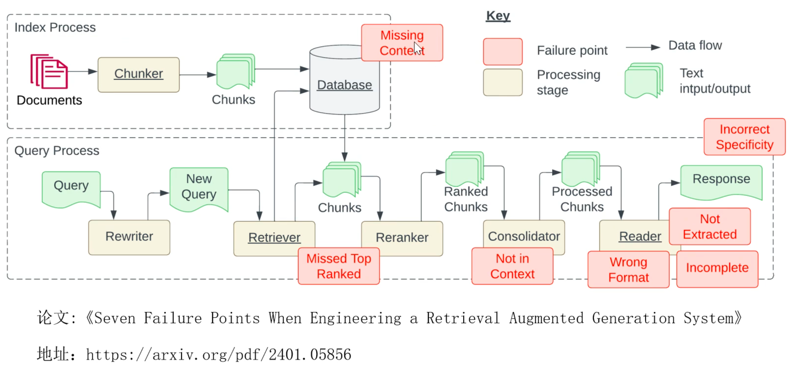
1. 问题一：知识库创建过程中（或索引创建过程中），内容缺失
知识库中压根就没有对应答案
2. 问题二：真正的答案并没有在top-k中，被丢弃了
3. 问题三：检索到chunk，重排序后，在对上下文进行整合时，有可能上下文中没有答案了。
因为上下文太长，会进行压缩把答案给整合掉了
4. 问题四：格式错误
5. 问题五：答案不完整
6. 问题六：上下文中是有答案的，但是大模型没提取到答案
7. 问题七：颗粒度不对，比如太细或太粗
#### （1）问题一：Missing Content 知识库内容缺失
RAG幻觉产生的根本原因与系统性应对策略：

根本原因：无中生有的“合理推断”
- 知识源头缺失：向量库原始数据未包含问题相关关键信息，基础为空。
- 模型幻觉触发：利用预训练知识强行“推断”，生成看似正确的错误答案。
- 逻辑闭环假象：编造内容具备语法连贯性，用户极易轻信而忽略真实性。
- 知识边界模糊：模型无法准确判断“不知道”，混淆已知与未知领域。

三重防线：系统性治理方案
- 增补： 补齐知识盲区，识别缺失领域，注入权威新知识源。
- 清洗：净化数据质量，剔除噪声、重复与错误数据干扰。
- 约束：明确Prompt，指令未知即说“不知道”。

为何 Missing Content 是 RAG 的致命伤？
RAG的核心逻辑是检索增强生成，即基于知识库中的事实进行回答。一旦用户的问题超出了知识库的覆盖范围，模型就会失去“缰绳”，退回到预训练的“幻觉模式”。
这种情况下，AI会像“一本正经地胡说八道”，利用语料库中的碎片信息拼凑出看似合理的答案。这不仅无法解决用户问题，还会传递错误信息，严重影响系统的可信度。因此，填补知识库空白、明确回答边界，是构建可靠RAG系统的第一道门槛。

#### （2）问题二：Missed Top Ranked 答案在库里，却没被召回
知识块与问题的向量相似度排名可能不够靠前，导致有效信息遗漏

核心诱因：信息检索的三大“拦路虎”
- 语义鸿沟障碍：提问表述与文档描述存在语境差异
- 模型捕捉局限：无法精准识别深层微妙的语义关联
- Top K 设置过低：截断阈值过高增加有效信息排除率
- 检索策略单一：缺乏多维度召回与重排序机制兜底

业务影响：LLM 回答质量的致命陷阱
- 答非所问：上下文缺失，关键信息未召回，逻辑无法闭环
- 产生幻觉：知识编造，模型强行生成答案，可信度极低
- 成本浪费：资源空转无效检索消耗算力与知识库资源

解决方案：top-k改大一些，并加入重排模型后再选出top-n

 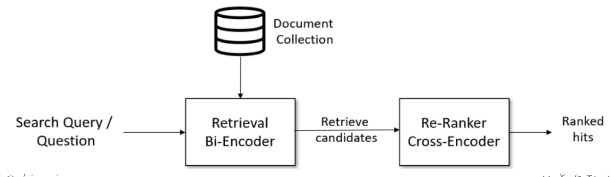


#### （3）问题三：Not in Context 上下文无关的核心痛点
本质：内容缺失或召回失败的外在表现

根本原因
- 源于内容缺失：知识库根本无对应答案，检索系统被迫返回无关内容填充上下文。
- 源于召回失利：正确答案块排名过低被截断，导致最终获取的上下文完全错误。

解决方案
- 核心诊断思路：向上游追溯，先检查知识库完整性，再排查检索日志的召回结果。
- 针对性解决措施：缺失则补充知识库，召回差则优化检索策略与排序算法。

Not in Context是RAG系统中典型的结果性痛点，指最终传递给LLM的上下文与用户问题完全无关。
这并非独立问题，而是上游知识库缺失关键信息或检索机制召回失败的集中体现。

#### （4）问题四：Wrong Format 答案内容对了，格式也可能错
需要 JSON 却返回字符串，是典型输出控制失败

递进式解决方案：从规范到闭环
- 方案一：Prompt 调优
明确规定输出为严格JSON对象
- 方案二：Pydantic 校验
定义数据模型，拦截非法格式
- 方案三：自动修复闭环
捕获错误提示，引导模型自纠
- 核心价值：稳定性保障
确保下游系统解析不出错

错误案例与影响分析
- JSON：解析失败风险，非结构化文本导致程序崩溃
- Format：开发调试成本，需处理大量边缘格式异常
- Stable：系统可靠性，标准化输出提升鲁棒性

为什么格式控制如此重要？
在LLM应用落地过程中，输出格式的正确性直接决定了系统的可用性。例如在自动工单处理、数据同步或API对接场景中，上游返回的内容如果包含多余的解释性文字、换行符或格式错误，会直接导致下游JSON解析器报错，引发服务中断。
单纯依赖Prompt工程虽然有效，但无法从根本上杜绝模型“即兴发挥”。引入Pydantic校验作为安全网，配合自动修复机制形成闭环，是目前工业级应用中保障格式稳定的最佳实践。

#### （5）问题五：Incomplete 回答覆盖不全的痛点与对策
复杂问题的拆解与系统性解决思路

根本原因：
- 问题过载：单个LLM调用难以承载复杂问题的全部逻辑，处理时容易遗漏关键要点，导致回答片面。
- 上下文不足：检索机制获取的知识库片段有限，仅能支撑问题的局部维度，无法满足全方位回答的信息需求。

解决方案：
Step 01 · 复杂问题结构化分解
利用LLM的逻辑分析能力，将一个宏观、复杂的母问题，自动拆解为多个逻辑清晰、相互独立且可被精准回答的子问题序列，明确回答边界。
Step 02 · 子问题逐一精准攻克
针对每个拆分后的子问题，分别执行独立的RAG检索流程，确保每个小问题都能匹配到最相关的上下文信息，生成针对性的准确回答。
Step 03 · 多维度答案整合汇总
收集所有子问题的独立回答，通过LLM进行最终的逻辑梳理与内容融合，形成结构完整、逻辑连贯且覆盖全面的最终回复。

#### （6）问题六： Not Extracted 关键信息提取的隐形痛点
答案在上下文里，却没被读出来的核心成因与对策

根本原因
- 场景直击：上下文含答案，但LLM生成时完全遗漏关键信息
- 信息淹没效应：上下文文本过长，模型注意力被无关内容分散
- 提取能力瓶颈：指令不够清晰或模型本身存在上下文理解盲区
- 问题本质：召回成功但提取失败，信噪比过低是核心关键

解决方案：
上下文压缩（Context Compression）
- 提纯：关键信息聚焦提炼与问题强相关的核心段落
- 过滤：剔除冗余噪音移除无关背景与干扰性描述
- 增效：提升准确率降低模型处理负荷，精准定位

#### （7）问题七：Incorrect Specificity 具体性也会失衡
核心痛点：信息粒度与用户预期的错位
大模型回答的详细程度若与用户预期不匹配，会出现两种极端：要么是毫无信息量的笼统答案，要么是堆砌细节的冗余回答，本质上是模型未能精准捕捉用户所需的信息粒度。

根本原因：
- 过于笼统 (General)：用户询问具体问题，模型仅反馈正确却无实质信息量的通用化结论。
- 过于细致 (Specific)：用户关注宏观问题，模型却罗列无关细节，造成信息过载让用户困惑。

本质根源：幻觉延伸：属于高级幻觉问题，核心是模型无法精准判断用户所需的信息颗粒度

解决方案：
现状：尚无完美解：目前行业仍缺乏公认的完美方案，需依赖更精细的意图识别技术突破。


### 2、RAG链路核心过程解析
1. 索引过程：知识库构建
涵盖内容加载、文本切分、向量化及索引构建，是决定知识库质量的核心基石。
2. 查询过程：问答与生成
通过查询理解、相似度匹配、上下文构建至LLM生成，决定检索响应的效率与精准度。
3. 关键痛点：故障传导效应
索引环节的质量缺陷会直接向下传导，对最终的问答结果产生不可逆的负面影响。
4. 解决方案：系统性全链路优化
优化工作不能割裂进行，必须覆盖索引与查询两大过程中的每一个关键技术环节。

## 二、Advanced RAG概述
全链路检索优化：
- 预检索优化 (Pre-retrieval)：在构建索引前优化数据粒度、添加元数据及查询改写，从源头提升数据质量。
- 检索优化 (Retrieval)：采用领域微调的Embedding模型与混合搜索技术，提升召回结果的精准度与相关性。
- 后检索优化 (Post-retrieval)：在生成回答前执行重排(Reranking)与上下文压缩，精炼信息，过滤噪音数据。
- 全流程组合拳：串联前、中、后全链路优化策略，从源头到末端系统性提升RAG系统的性能与可靠性。

### 1、Pre-Retrieval 预检索-优化索引
痛点分析：
在处理大量文档时，如何快速准确地找到所需信息是一个常见挑战。摘要索引可以用来处理半结构化数据，比如许多文档包含多种内容类型，包括文本和表格。这种半结构化数据对于传统 RAG 来说可能具有挑战性，文本拆分可能会分解表，从而损坏检索中的数据；嵌入表可能会给语义相似性搜索带来挑战。

索引优化方案：
- 摘要索引
- 父子索引
- 假设性问题索引
- 元数据索引

#### （1）摘要索引
多向量检索器 MultiVectorRetriever
 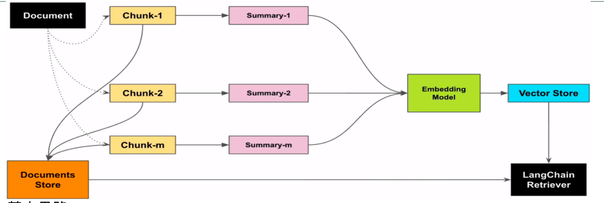

1. 基本思路：
- 让LLM为每个块生成summary，并作为embedding存到summary database中
- 在检索时，通过summary database找到最相关的summary，再回溯到原始文档中去
- 将原始文本块作为上下文发送给LLM以获取答案

2. 适用性分析：
半结构化数据：
- 摘要索引通常用来处理半结构化数据，比如许多文档包含多种内容类型（文本、表格、图片）。
- Mineru，用于解析表格、图片等。

3. 使用场景：高价值表格
- 金融年报：包含大量关键财务数据表（资产负债、利润表）
- 医疗/药品说明书：复杂的临床数据表、不良反应发生率。
- 工业技术文档：包含精密规格参数、设备运行指标的表格。
建议：在实际RAG应用中，需要根据文档做A/B测试。

一般拆分：先按照章节拆分，在章节内部再按照语义拆分、再把表格提取出来，标记出位置
```
from langchain_classic.retrievers import MultiVectorRetriever, SelfQueryRetriever
from langchain_chroma import Chroma
from langchain_core.stores import InMemoryByteStore


from langchain_community.document_loaders import TextLoader # 文本加载器，用于加载文档
from langchain_text_splitters import RecursiveCharacterTextSplitter # 递归文本分割器

import uuid   # 用于生成唯一标识符
from langchain_core.documents import Document    # 文档对象
from langchain_core.output_parsers import StrOutputParser   # 字符串输出解析器
from langchain_core.prompts import ChatPromptTemplate  # 聊天提示模板
from langchain_core.runnables import RunnableMap, RunnableParallel  # 可运行的映射

from models import get_ali_clients   # 自定义模块，用于获取阿里云大模型和嵌入模型客户端


from models import  get_ali_clients

#摘要索引示例代码

# 1.提取，分割，块（比较大）
# 2.块，生成摘要
# 3.将摘要向量化， 摘要和原始文档要建立关系
# 4.摘要向量存储到向量数据库中，原始文档存储（不是存到向量数据库）
# 5.检索，匹配摘要向量，返回原始文档


# 注意事项：
# 1.摘要质量至关重要
#  这是一个关于deepseek的介绍文章  太过于简单，丢失了关键信息
# 2.存储开销比较大
# 只存储知识块对应的向量    摘要索引：纪要存储摘要的向量还要存储原始文档
# 3.一致性问题，维护一致性
# 通过uuid 将原始文档和摘要一一对应

#获得访问大模型和嵌入模型客户端
client,embeddings_model = get_ali_clients()

# 初始化文档加载器
loader = TextLoader("./deepseek百度百科.txt", encoding="utf-8")

# 加载文档
docs = loader.load()

# 初始化递归文本分割器（设置块大小和重叠）
text_splitter = RecursiveCharacterTextSplitter(chunk_size=1024, chunk_overlap=100)
docs = text_splitter.split_documents(docs)  

# 创建摘要生成链
chain = (
    {"doc": lambda x: x.page_content}  
    | ChatPromptTemplate.from_template("总结下面的文档:\n\n{doc}")  
    | client
    | StrOutputParser()  
)

print("准备生成文档摘要，请耐心等待...")
# 批量生成文档摘要（最大并发数5）
summaries = chain.batch(docs, {"max_concurrency": 5})

# print(summaries)
#
# exit()

# 初始化Chroma实例（用于存储摘要向量）
vectorstore = Chroma(
    collection_name="summaries",  
    embedding_function=embeddings_model
)

# 初始化内存字节存储（用于存储原始文档）
store = InMemoryByteStore()

# 初始化多向量检索器（结合向量存储和文档存储）
id_key = "doc_id"  
retriever = MultiVectorRetriever(
    vectorstore=vectorstore, 
    byte_store=store,  
    id_key=id_key,  
)

# 为每个文档生成唯一ID，该ID用于关联原始文档和摘要
doc_ids = [str(uuid.uuid4()) for _ in docs]


# 将文档摘要转换为LangChain中Document
summary_docs = [
    Document(page_content=s, metadata={id_key: doc_ids[i]})
    for i, s in enumerate(summaries)
]

# 将摘要添加到向量数据库
print("准备将摘要添加到向量数据库...")
retriever.vectorstore.add_documents(summary_docs)

# 将原始文档存储到字节存储（使用ID关联）
print("准备将原始文档存储到字节存储...")
# mset：批量设置键值对
# list(zip(doc_ids, docs))：将ID和文档配对
retriever.docstore.mset(list(zip(doc_ids, docs)))

# # 手动测试代码 - 相似性搜索
# query = "deepseek的企业事件"
# sub_docs = retriever.vectorstore.similarity_search(query)
# print("-------------匹配的摘要内容--------------")
# print(sub_docs[0])
#
# # 获取第一个匹配摘要的ID
# matched_id = sub_docs[0].metadata[id_key]
#
# print(f"-------------对应的原始文档--------------")
# # 通过ID获取原始文档
# original_doc = retriever.docstore.mget([matched_id])
# print(original_doc)
# # 执行相似性搜索测试---完成
# exit()


prompt =  ChatPromptTemplate.from_template("根据下面的文档回答问题:\n\n{doc}\n\n问题: {question}") 
# 生成问题回答链
#RunnableMap是RunnableParallel另一种写法
#retriever.invoke将上面对摘要进行检索，但是通过关联ID获得原始文档，最终返回原始文档的过程全部都包含完成了
chain = RunnableMap({
    "doc": lambda x: retriever.invoke(x["question"]),
    "question": lambda x: x["question"]
}) | prompt | client | StrOutputParser()

# 生成问题回答
query = "deepseek的企业事件"
answer = chain.invoke({"question": query})
print("-------------回答--------------")
print(answer)
# retriever.invoke(query)  1.向量数据库中检索摘要向量   2.匹配对应的原始文档并返回
retrieved_docs = retriever.invoke(query) 
print("-------------检索到的文档--------------")
print(retrieved_docs)
```

#### （2）父子索引 
LangChain中父子文档检索器 ParentDocumentRetriever

1. 痛点分析：
我们在利用大模型进行文档检索的时候，常常会有相互矛盾的需求，比如：
1.你可能希望得到较小的文档块，以便它们Embedding以后能够最准确地反映出文档的含义，如果文档块太大，Embedding就失去了意义。
2.你可能希望得到较大的文档块以保留较多的内容，然后将它们发送给LLM以便得到全面且正确的答案。

2. 基本思路：
文档被分割成一个层级化的块结构，随后用最小的叶子块进行索引
- 在检索过程中检索出top k个叶子块
- 如果存在n个叶子块都指向同一个更大的父块，那么我们就用这个父块来替换这些子块，并将其送入大模型用于生成答案。
 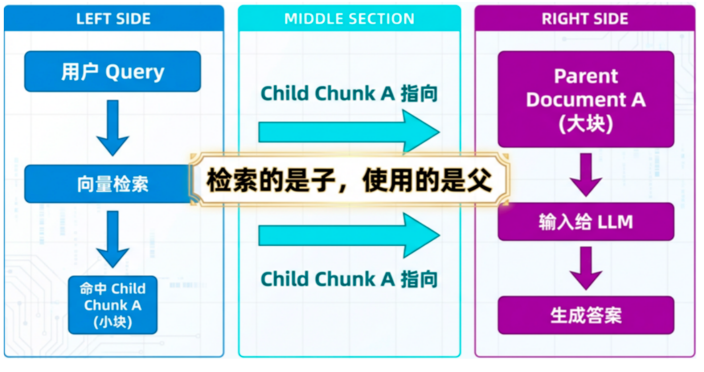

3. 注意事项：
- 文档有清晰的结构层次
- 需要保持上下文的完整性
- 用户查询通常针对具体细节
- 信息碎片化可能造成误解
4. 应用场景：
- 技术文档检索（如API文档）
- 书籍内容检索
- 代码库检索
```
import os

from langchain_classic.retrievers import ParentDocumentRetriever
from langchain_community.document_loaders import WebBaseLoader, TextLoader
from langchain_chroma import Chroma
from langchain_text_splitters import RecursiveCharacterTextSplitter
from langchain_community.embeddings.dashscope import DashScopeEmbeddings

from langchain_core.stores import InMemoryStore
from  langchain_openai.chat_models import ChatOpenAI
from langchain_core.prompts import ChatPromptTemplate
from langchain_core.runnables import RunnableMap
from langchain_core.output_parsers import StrOutputParser
from models import get_lc_model_client, get_baichuan_embeddings, get_tencent_clients, get_a_t_mix_clients, \
    get_ali_clients

#父子索引示例代码

#获得访问大模型和嵌入模型客户端
client,embeddings_model = get_ali_clients()

# 加载数据
loader = TextLoader("./deepseek百度百科.txt",encoding="utf-8")
docs = loader.load()

# 查看长度
print(f"文章的长度：{len(docs[0].page_content)}")

# 子块是父块内容的子集
#创建主文档分割器
parent_splitter = RecursiveCharacterTextSplitter(chunk_size=1024)

#创建子文档分割器
child_splitter = RecursiveCharacterTextSplitter(chunk_size=256)

# 创建向量数据库对象
vectorstore = Chroma(
    collection_name="split_parents", embedding_function = embeddings_model
)
# 创建内存存储对象
store = InMemoryStore()
#创建父子文档检索器，帮我们通过检索子块，返回父文档块
retriever = ParentDocumentRetriever(
    vectorstore=vectorstore,
    docstore=store, # 文档存储对象
    child_splitter=child_splitter, # 子文档分割器，子文档存储到向量数据库
    parent_splitter=parent_splitter,# 主文档分割器，主文档存储到内存中
    search_kwargs={"k": 1}  # topK = 1,相似度最高的子文档块
)
# topK = 2,相似度最高的子文档块（A,B） A,B属于同一个父， 父文档块被查询两次，不会去重

#添加文档集
retriever.add_documents(docs)

print(f"主文块的数量：{len(list(store.yield_keys()))}")

# 测试 - 相似性搜索
'''这里我们通过向量数据库的similarity_search方法搜索出来的是与用户问题相关的子文档块的内容，
下面我们使用检索器的get_relevant_documents的方法来对这个问题进行检索，
它会返回该子文档块所属的主文档块的全部内容： '''
# print("------------similarity_search------------------------")
# sub_docs = vectorstore.similarity_search("deepseek的应用场景")
# print(sub_docs[0].page_content)
#
# print("------------get_relevant_documents-----------通过子找父-------------")
# retrieved_docs = retriever.invoke("deepseek的应用场景")
# print(retrieved_docs[0].page_content)
# # 测试 - 相似性搜索 - 完成
# exit()

#创建prompt模板
template = """请根据下面给出的上下文来回答问题:
{context}
问题: {question}
"""

#由模板生成prompt
prompt = ChatPromptTemplate.from_template(template)

#创建chain
chain = RunnableMap({
    "context": lambda x: retriever.invoke(x["question"]),
    "question": lambda x: x["question"]
}) | prompt | client | StrOutputParser()

print("------------模型回复------------------------")

response = chain.invoke({"question": "deepseek的应用场景"})
print(response)
```
#### （3）假设性问题索引
多向量检索器 MultiVectorRetriever

假设性问题是一种提问方式，它基于一个或多个假设的情况或前提来提出问题。在对知识库中文档内容进行切片时，是可以以该切片为假设条件，利用LLM预先设置几个候选的相关性问题的，也就是说，这几个候选的相关性问题是和切片的内容强相关的。


1. 基本思路：
- 让LLM为每个块生成3个假设性问题，并将这些问题以向量形式嵌入
- 在运行时，针对这个问题向量的索引进行查询搜索（用问题向量替换文档的块向量）
- 检索后将原始文本块作为上下文发送给LLM以获取答案

 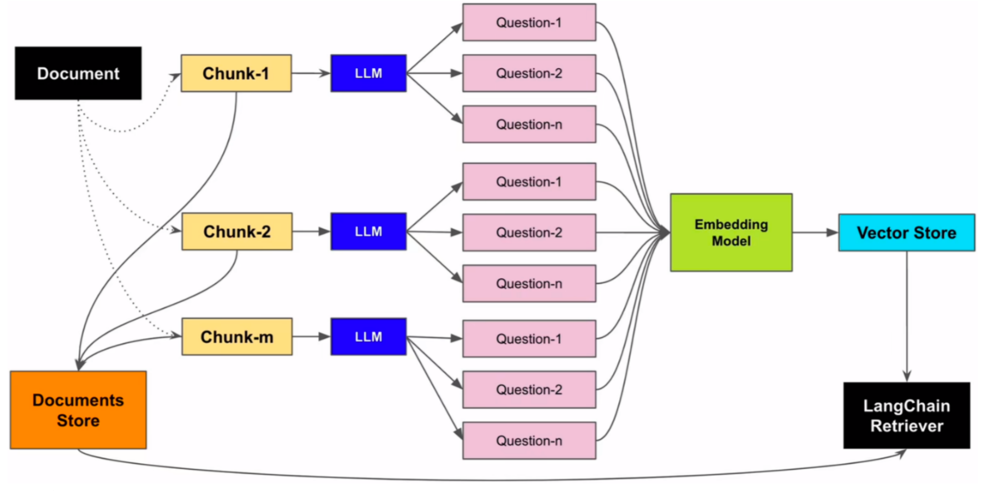

```
import langchain
from typing import List

from langchain_classic.retrievers import MultiVectorRetriever
from langchain_community.document_loaders import TextLoader
from langchain_chroma import Chroma
from langchain_core.stores import InMemoryByteStore
from langchain_text_splitters import RecursiveCharacterTextSplitter
import uuid
from langchain_core.documents import Document  
from langchain_core.output_parsers import StrOutputParser  
from langchain_core.prompts import ChatPromptTemplate  
from langchain_core.runnables import RunnableMap, RunnableParallel
from pydantic import BaseModel, Field
from models import get_lc_model_client, get_baichuan_embeddings, get_tencent_clients, get_ali_clients

# 假设性问题索引示例代码
#获得访问大模型和嵌入模型客户端
client,embeddings_model = get_ali_clients()

# 初始化文档加载器列表
loader = TextLoader("./deepseek百度百科.txt",encoding="utf-8")
docs = loader.load()

# 初始化递归文本分割器（设置块大小和重叠）
text_splitter = RecursiveCharacterTextSplitter(chunk_size=1024, chunk_overlap=100)
docs = text_splitter.split_documents(docs)

# 初始化Chroma向量数据库（存储生成的问题向量）
vectorstore = Chroma(
    collection_name="hypo-questions", embedding_function=embeddings_model
)
# 初始化内存存储（存储原始文档）
store = InMemoryByteStore()

id_key = "doc_id" # 文档标识键名

# 配置多向量检索器
retriever = MultiVectorRetriever(
    vectorstore=vectorstore, #  向量数据库，存储生成的问题向量（调用对话模型生成）
    byte_store=store, # 字节存储，存储原始文档
    id_key=id_key,
)

# 为每个原始文档生成唯一ID
doc_ids = [str(uuid.uuid4()) for _ in docs]

#以下开始用大模型生成假设性问题
#这个类的作用参见创建假设性问题链chain的注释
class HypotheticalQuestions(BaseModel):
    """约束生成假设性问题的格式"""
    questions: List[str] = Field(..., description="List of questions")

#此处使用双括号 {{ 和 }} 是为了在字符串中转义出单个 { 和 }，以确保最终输出的 JSON 格式正确。
prompt = ChatPromptTemplate.from_template(
        """请基于以下文档生成3个假设性问题（必须使用JSON格式）:
        {doc}
        
        要求：
        1. 输出必须为合法JSON格式，包含questions字段
        2. questions字段的值是包含3个问题的数组
        3. 使用中文提问
        示例格式：
        {{
            "questions": ["问题1", "问题2", "问题3"]
        }}"""
)

# 创建假设性问题链
'''
其中的client.with_structured_output可以理解为输出解析器的一种更高级用法
将大模型的输出转换为HypotheticalQuestions所限定的格式，
而HypotheticalQuestions要求的格式是：
定义了一个字段 questions，它具有以下特性：
类型注解：List[str] 表示 questions 字段应该是一个字符串列表。
必需性：Field(...) 中的省略号 ... 表示这个字段是必需的。
描述信息：description="List of questions" 为该字段添加了描述，这对于生成文档或帮助理解模型结构很有用。
'''
chain = (
    {"doc": lambda x: x.page_content}
    | prompt
    # 将LLM输出构建为字符串列表
    | client.with_structured_output(
        HypotheticalQuestions
    )
    # 提取问题列表
    | (lambda x: x.questions)
)

# 测试-在单个文档上调用链，链的最终输出是大模型答复的假设性问题列表
# print("测试：",docs[0])
# print("测试生成问题：",chain.invoke(docs[0]))

# 批量处理所有文档生成假设性问题（最大并行数5），每个切块后的文档块都对应的生成三个问题
hypothetical_questions = chain.batch(docs, {"max_concurrency": 5})
# print("假设性问题列表：",hypothetical_questions)

# 将生成的问题转换为带元数据的文档对象
question_docs = []
for i, question_list in enumerate(hypothetical_questions):
    question_docs.extend(
        [Document(page_content=s, metadata={id_key: doc_ids[i]}) for s in question_list]
    )

print(question_docs)

exit()
retriever.vectorstore.add_documents(question_docs) # 将问题文档存入向量数据库
retriever.docstore.mset(list(zip(doc_ids, docs))) # 将原始文档存入字节存储（通过ID关联）
#以上的过程是可以在构建知识库的时候提前完成的

# 测试-执行相似性搜索
query = "deepseek受到哪些攻击？"
# sub_docs = retriever.vectorstore.similarity_search(query)
# print("-------------相似性：--------------")
# print("测试-执行相似性搜索：",sub_docs)

prompt1 =  ChatPromptTemplate.from_template("根据下面的文档回答问题:\n\n{doc}\n\n问题: {question}") 

# 生成问题回答链
chain = RunnableParallel({
    "doc": lambda x: retriever.invoke(x["question"]),
    "question": lambda x: x["question"]
}) | prompt1 | client | StrOutputParser()
 
# 生成问题回答
answer = chain.invoke({"question": query})
print("-------------回答--------------")
print(answer)
#  返回的是知识块
retrieved_docs = retriever.invoke(query) 
print("-------------检索到的问题--------------")
print(retrieved_docs)
```
#### （4）元数据索引
自查询检索器 SelfQueryRetriever

1. 痛点分析
在企业复杂的知识密集型应用中，可能会面临几百个不同来源与类型的知识文档。如果只是简单地依赖传统的文本分割与 top-k 检索，就会产生精度不足、知识相互干扰等问题，从而导致效果不佳。想象一下，你想在一个医学文献数据库中查找关于“糖尿病足”的资料，但数据库中也充斥着大量关于其他糖尿病并发症的信息。
一个重要的优化方法是在大文档集下“分层”过滤与检索。比如元数据索引。

元数据是对文档的一种属性描述，假设我们使用一个存储了大量科技博客文章的向量数据库。每篇文章都关联了以下标签：
topic: 人工智能, 区块链, 云计算, 大数据
author: 作者A, 作者B, 作者C
year: 2022, 2023, 2024

2. 基本思路：
- 定义元数据标签，如果文档本身没有，可以利用大模型推理出输入问题的元数据
- 通过标签先对文档进行过滤
- 结合向量检索进一步定位到最相关的前 K 个知识块

3. LangChain 中使用SelfQueryRetriever自查询检索器实现

 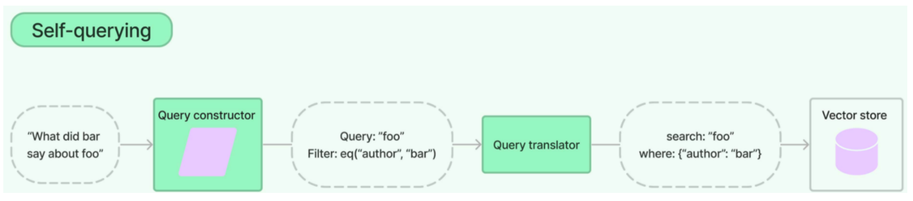

```
from langchain_community.vectorstores import Chroma
from langchain_classic.chains.query_constructor.base import StructuredQueryOutputParser,get_query_constructor_prompt
from langchain_classic.chains.query_constructor.schema import AttributeInfo
from langchain_classic.retrievers import SelfQueryRetriever
from langchain_core.documents import Document
from models import get_lc_model_client, get_baichuan_embeddings, get_tencent_clients, get_ali_clients, \
    get_a_t_mix_clients

# 元数据索引示例代码

#获得访问大模型和嵌入模型客户端
llm,embeddings_model = get_ali_clients()

# 加载文档
docs = [
    Document(
        page_content="作者A团队开发出基于人工智能的自动驾驶决策系统，在复杂路况下的响应速度提升300%",
        metadata={"year": 2024, "rating": 9.2, "genre": "AI", "author": "A"},
    ),
    Document(
        page_content="区块链技术成功应用于跨境贸易结算，作者B主导的项目实现交易确认时间从3天缩短至30分钟",
        metadata={"year": 2023, "rating": 9.8, "genre": "区块链", "author": "B"},
    ),
    Document(
        page_content="云计算平台实现量子计算模拟突破，作者C构建的新型混合云架构支持百万级并发计算",
        metadata={"year": 2022, "rating": 8.6, "genre": "云", "author": "C"},
    ),
    Document(
        page_content="大数据分析预测2024年全球经济趋势，作者A团队构建的模型准确率超92%",
        metadata={"year": 2023, "rating": 8.9, "genre": "大数据", "author": "A"},
    ),
    Document(
        page_content="人工智能病理诊断系统在胃癌筛查中达到三甲医院专家水平，作者B获医疗科技创新奖",
        metadata={"year": 2024, "rating": 7.1, "genre": "AI", "author": "B"},
    ),
    Document(
        page_content="基于区块链的数字身份认证系统落地20省市，作者C设计的新型加密协议通过国家级安全认证",
        metadata={"year": 2022, "rating": 8.7, "genre": "区块链", "author": "C"},
    ),
    Document(
        page_content="云计算资源调度算法重大突破，作者A研发的智能调度器使数据中心能效提升40%",
        metadata={"year": 2023, "rating": 8.5, "genre": "云", "author": "A"},
    ),
    Document(
        page_content="大数据驱动城市交通优化系统上线，作者B团队实现早晚高峰通行效率提升25%",
        metadata={"year": 2024, "rating": 7.4, "genre": "大数据", "author": "B"},
    )
]

vectorstore = Chroma.from_documents(docs, embeddings_model)

# 元数据字段定义（指导LLM如何解析查询条件）
metadata_field_info = [
    AttributeInfo(
        name="genre",
        description="文章的技术领域，选项:['AI '，'区块链'，'云'，'大数据']",
        type="string",
    ),
    AttributeInfo(
        name="year",
        description="文章的出版年份",
        type="integer",
    ),
    AttributeInfo(
        name="author",
        description="署名文章的作者姓名",
        type="string",
    ),
    AttributeInfo(
        name="rating",
        description="技术价值评估得分（1-10分）",
        type="float"
    )
]
# 文档内容描述（指导LLM理解文档内容）
document_content_description = "技术文章简述"

# 创建自查询检索器（核心组件）
'''SelfQueryRetriever 是 langchain 库中的一个工具，其主要功能是把自然语言查询转变为结构化查询，
以此提升检索的精准度。它整合了检索器和语言模型，能依据查询内容自动推断出筛选条件，还能识别出相关的元数据字段。'''
retriever = SelfQueryRetriever.from_llm(
    llm,
    vectorstore,
    document_content_description,
    metadata_field_info,
    # enable_limit=True, 限定只返回一个结果
)

# print("---------------------评分在9分以上的文章-------------------------------")
# #查询条件：查询只约束分数 rating>9
# print(retriever.invoke("我想了解评分在9分以上的文章"))
#
# print("---------------------作者B在2023年发布的文章-------------------------------")
# # 第二个查询只约束作者和年份 author="B", year=2023
# print(retriever.invoke("作者B在2023年发布的文章"))


# 原理：构建查询解析器（分析内部工作机制用）
'''构建查询提示模板
document_content_description：对文档内容的概括性描述，例如 "有关各种主题的文章"。
metadata_field_info：元数据字段的详细描述，涵盖字段名称、类型以及描述。
此函数会生成一个提示模板，其用途是指导语言模型如何将自然语言查询转换为结构化查询。'''
prompt = get_query_constructor_prompt(
    document_content_description,
    metadata_field_info,
)
#解析器的作用是把语言模型的输出转换为 StructuredQuery 对象，
# 这个对象包含了 query（文本查询）和 filter（元数据筛选条件）
output_parser = StructuredQueryOutputParser.from_components()
#链式操作，先将用户查询填入提示模板，接着由语言模型生成结构化输出，最后通过解析器得到结构化查询。
query_constructor = prompt | llm | output_parser

# 打印查询构造提示
print("提示词：",prompt.format(query="我想了解评分在9分以上的文章"))
print("提示词显示结束--------------------------提示词显示结束----------------------")

# 打印结构化查询的结果
print("结构化查询结果：",query_constructor.invoke(
    {
        "query": "作者B在2023年发布的文章"
    }
))
# 看工作原理-结束
```

#### 索引优化小结
1. 摘要索引
- 适用场景：适用于需要快速检索和生成简洁上下文的场景。
- 案例：在新闻资讯平台中，系统需要快速从海量新闻中提取关键信息，通过摘要索引可以迅速生成简洁的上下文，帮助用户快速了解新闻的核心内容。

2. 父子索引
- 适用场景：适用于需要确保语义完整性和层次化检索的场景。
- 案例：在法律检索系统中，用户查询法律条款时，父子索引通过分层检索精准查找相关内容，并召回对应大文档块确保上下文的完整性，避免因分块过细导致语义丢失。

3. 假设性问题索引
- 适用场景：适用于需要处理复杂查询和多样化表达的场景。
- 案例：在药品咨询系统中，用户查询症状时可能会问：“感冒了吃什么药？”。假设性问题索引通过为每种药品生成一系列假设性问题，帮助用户更准确地检索到相关信息。

4. 元数据索引
- 适用场景：适用于需要快速筛选和分类的场景。
- 在电商推荐系统中，系统通过元数据索引快速筛选出符合用户偏好的商品信息，提高推荐效率和准确性。


### 2、Pre-Retrieval 预检索-查询优化
主要分为：
- Enrich完善问题
- Multi-Query 多路召回
- Decomposition 问题分解

#### （1）Enrich完善问题
1. 痛点分析：
我们希望实现让人们通过自然的口语对话来使用大模型应用。然而，在口语表达需求和意图时，人们往往会遇到一些问题。例如，表达过于简略或含糊，容易引发语义歧义，导致大模型产生误解；用户的问题可能包含许多隐含要素，但表达的信息却不足，只能通过多轮对话逐步补全；

理想情况：通过大模型多次主动与用户沟通，不断收集信息，完善对用户真实意图的理解，补全执行用户需求所需的各项参数。

 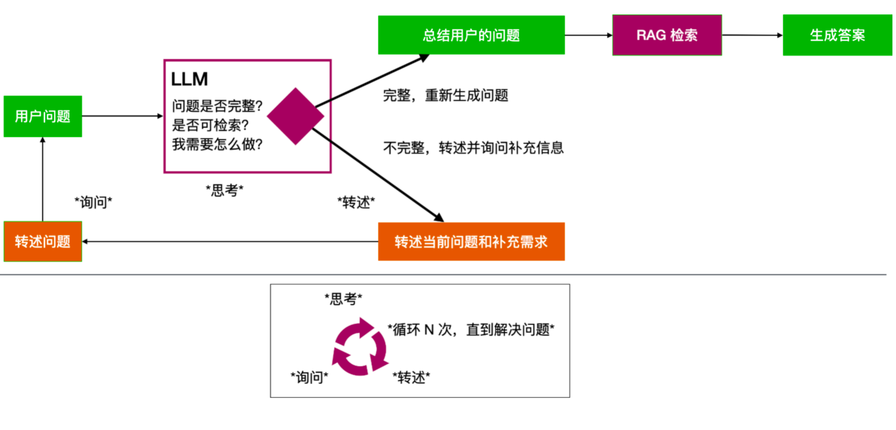

 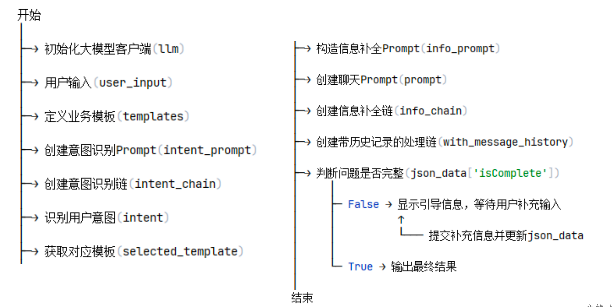

```
from langchain_community.embeddings.dashscope import DashScopeEmbeddings
from langchain_openai import ChatOpenAI
from langchain_core.prompts import PromptTemplate, ChatPromptTemplate

from langchain_core.runnables.history import RunnableWithMessageHistory
from langchain_community.chat_message_histories import ChatMessageHistory
from langchain_core.output_parsers import JsonOutputParser
import json
import os
from dotenv import load_dotenv

load_dotenv()

# 加载模型参数
model = "qwen-max"
api_key = os.getenv("DASHSCOPE_API_KEY")
api_base_url = "https://dashscope.aliyuncs.com/compatible-mode/v1"

llm = ChatOpenAI(
    model=model,
    api_key=api_key,
    openai_api_base=api_base_url
)

embeddings_model = DashScopeEmbeddings(model="text-embedding-v1")

# 示例业务模板
templates = {
    "订机票": ["起点", "终点", "时间", "座位等级", "座位偏好"],
    "订酒店": ["城市", "入住日期", "退房日期", "房型", "人数"],
}
print(str(list(templates.keys())))
# 意图识别提示模板
intent_prompt = PromptTemplate(
    input_variables=["user_input", "templates"],
    template="根据用户输入 '{user_input}'，选择最合适的业务模板。可用模板如下：{templates}。请返回模板名称。"
)

# 创建意图识别链
intent_chain = intent_prompt | llm

# 模拟用户输入
user_input = input("请输入问题：")

# 识别意图
intent = intent_chain.invoke({"user_input": user_input, "templates": str(list(templates.keys()))}).content

print("意图：", intent)
# 获取对应模板
selected_template = templates.get(intent)
print("模板：", selected_template)

# 补充信息提示模板
info_prompt = f"""
    请根据用户原始问题和模板，判断原始问题是否完善。如果问题缺乏需要的信息，请生成一个友好的请求，明确指出需要补充的信息。若问题完善后，返回包含所有信息的完整问题。
    只回答跟模板信息相关匹配的答案，其他问题不回复。
    
 
    ### 原始问题    
    {user_input}

    ### 模板
    {",".join(selected_template)}                                   

    ### 输出示例
    {{
        "isComplete": true,
        "content": "`完整问题`"
    }}
    {{
        "isComplete": false,
        "content": "`引导语 或 完整整理后的问题`"
    }}                                       
"""

# 历史记录
chat_history = ChatMessageHistory()

# 聊天模版
prompt = ChatPromptTemplate.from_messages(
    [
        ("system", "你是一个信息补充助手，任务是分析用户问题是否完整。"),
        ("placeholder", "{history}"),  # 历史记录的占位
        ("human", "{input}"),
    ]
)

# 补充信息链
info_chain = prompt | llm

# 自动处理历史记录，将记录注入输入并在每次调用后更新它
with_message_history = RunnableWithMessageHistory(
    info_chain,
    lambda session_id: chat_history,
    input_messages_key="input",
    history_messages_key="history",
)

# 判断问题是否完整，如果不完整，则生成追问请求
info_request = with_message_history.invoke(input={"input": info_prompt},
                                           config={"configurable": {"session_id": "unused"}}).content
parser = JsonOutputParser()
json_data = parser.parse(info_request)
print(json_data)
# 循环判断是否完整，并提交用户补充信息
while json_data.get('isComplete', False) is False:
    try:
        # 显示引导信息并等待用户输入
        user_answer = input(f"\033[1;33m{json_data['content']}\033[0m\n你的回复：")

        # 提交补充信息给AI处理
        info_request = with_message_history.invoke(
            input={"input": user_answer},
            config={"configurable": {"session_id": "unused"}}
        ).content

        # 解析AI响应
        json_data = parser.parse(info_request)

    except json.JSONDecodeError:
        print("\033[1;31m[错误] AI返回了无效的JSON格式，请重试\033[0m")
        continue
    except KeyError:
        print("\033[1;31m[错误] 响应格式异常，正在终止流程\033[0m")
        break

# 输出最终结果
print(f"\033[1;32m[最终查询] {info_request}\033[0m")
```

#### （2）Multi-Query 多路召回
使用 LangChain 的 MultiQueryRetriever

1. 痛点分析
当用户没有正确书写查询语句，或者LLM不能够正确理解用户查询语句的含义时，此时LLM生成的答案可能就不够完整和全面。

当用户输入查询语句(自然语言)时，我们让大模型(LLM)基于用户的问题再生成多个查询语句，这些生成的查询语句是对用户查询语句的补充，它们是从不同的视角来补充用户的查询语句，然后每条查询语句都会从向量数据库中检索到一批相关文档，最后所有的相关文档都会被喂给LLM，这样LLM就会生成比较完整和全面的答案。这样就可以避免因为查询语句的差异而导致结果不正确

- 利用 LLM 生成 N 个与原始查询相关的问题
- 将所有问题（加上原始查询）发送给检索系统。
- 通过这种方法，可以从向量库中检索到更多文档。

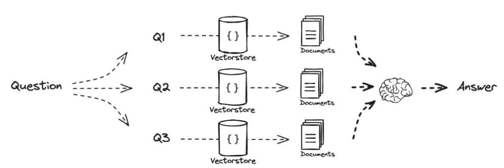

使用场景：问题比较模糊，动态查询意图、灵活

```
from langchain_core.load import dumps, loads
from operator import itemgetter
from langchain_classic.retrievers import MultiQueryRetriever
from langchain_community.document_loaders import TextLoader
from langchain_community.vectorstores import Chroma
from langchain_core.output_parsers import StrOutputParser
from langchain_core.prompts import ChatPromptTemplate
from langchain_core.runnables import RunnableMap, RunnableLambda
from langchain_text_splitters import RecursiveCharacterTextSplitter
from models import get_a_t_mix_clients, get_ali_clients
#Multi-Query 多路召回
#获得访问大模型和嵌入模型客户端
llm,embeddings_model = get_ali_clients()

# 加载文档
loader = TextLoader("./deepseek百度百科.txt",encoding="utf-8")
docs = loader.load()

# 创建文档分割器，并分割文档
text_splitter = RecursiveCharacterTextSplitter(chunk_size=600, chunk_overlap=100)
splits = text_splitter.split_documents(docs)

# 创建向量数据库
vectorstore = Chroma.from_documents(documents=splits, 
                                    embedding=embeddings_model)
# 创建检索器
retriever = vectorstore.as_retriever()

# #检索测试
relevant_docs= retriever.invoke('deepseek的应用场景')
print(relevant_docs)
#查看一下检索到的相关文档的数量：
print("检索器检索的文档数量为：",len(relevant_docs))
# #检索测试-完成


#创建prompt模板
template = """请根据下面给出的上下文来回答问题:
{context}
问题: {question}
"""

#由模板生成prompt
prompt = ChatPromptTemplate.from_template(template)

# 用来并发的生成N个类似的提问
chain = RunnableMap({
    "context": lambda x: relevant_docs,
    "question": lambda x: x["question"]
}) | prompt | llm | StrOutputParser()

print("--------------优化前-------------------")
response = chain.invoke({"question": "deepseek的应用场景"})
print("没有多路召回前，大模型生成的回答：",response)
# 以上是没有多路召回时，我们的大模型生成的回答


print("--------------开始优化-------------------")
#方法一：使用langchain的MultiQueryRetriever
#引入日志组件查看llm在原查询的基础上生成的多个查询
# import logging
# logging.basicConfig()
# # logging.getLogger("langchain.retrievers.multi_query").setLevel(logging.INFO)
# logging.getLogger("langchain_classic.retrievers.multi_query").setLevel(logging.INFO)
#
# # MultiQueryRetriever是对查询的优化
# retrieval_from_llm = MultiQueryRetriever.from_llm(
#     retriever=retriever,
#     llm=llm
# )
# # retrieval_from_llm.verbose = True
#
# unique_docs = retrieval_from_llm.invoke({"question":'deepseek的应用场景'})
# print(unique_docs)
# print(len(unique_docs))
#
# exit()


#方法二：自定义prompt
# prompt模版
template = """你是一个AI语言模型助手。你的任务是生成5个给定用户问题的不同版本，以从向量中检索相关文档
数据库。通过对用户问题产生多种观点，你的目标是提供帮助用户克服了基于距离的相似性搜索的一些限制。
提供了这些用换行符隔开的可选问题。原始问题: {question}"""

prompt_perspectives = ChatPromptTemplate.from_template(template)
generate_queries = (
    prompt_perspectives 
    | llm
    | StrOutputParser() 
    | (lambda x: x.split("\n"))
)
print("--------------自定义prompt生成的扩展问题-------------------")
response = generate_queries.invoke({"question":'deepseek的应用场景'})
print(response)


'''接下来我们使用所有的查询语句（假设为n个）去检索向量数据库，
理论上每条查询语句都会检索出4个相关文档，
那么总共可以检索出 n* 4 个相关文档，但是由于这些查询语句含义相近，
而已检索出来的相关文档可能出现重复，
因此我们必须过滤掉重复的相关文档,只保留唯一的文档'''
# @chain
def get_unique_union(documents: list[list]):
    """ 获取检索文档的唯一并集 """
    # 将列表中的列表展开，并将每个 Document 转换为字符串
    flattened_docs = [dumps(doc) for sublist in documents for doc in sublist]
    # 文档去重
    unique_docs = list(set(flattened_docs))
    # 返回去重后的文档列表
    return [loads(doc) for doc in unique_docs]

# 进行检索
'''retriever.map() 的作用是对输入的查询列表中的每个查询分别进行检索操作，
并返回每个查询对应的检索结果列表。
假设 generate_queries 生成了以下查询列表：["deepseek的应用场景", "deepseek的使用方法", 
"deepseek的优势"]
retriever.map() 对每个查询进行检索，假设检索结果如下：
对于查询 "deepseek的应用场景"，检索到文档列表 docs1,docs2。
对于查询 "deepseek的使用方法"，检索到文档列表 docs2。
对于查询 "deepseek的优势"，检索到文档列表 docs3。
因此，retriever.map() 的输出将是：[docs1,docs2, docs2, docs3]'''
question = "deepseek的应用场景"
retrieval_chain = generate_queries | retriever.map() | RunnableLambda(get_unique_union)
docs = retrieval_chain.invoke({"question":question})
# 去除重复后的知识库数量
print(docs)
print(len(docs))

print("--------------优化后-------------------")
template = """请根据下面给出的上下文来回答问题:
{context}
问题: {question}
"""

prompt = ChatPromptTemplate.from_template(template)

final_rag_chain = (
    {"context": retrieval_chain, 
    "question": itemgetter("question")}
    | prompt
    | llm
    | StrOutputParser()
)


question = "deepseek的应用场景"
response = final_rag_chain.invoke({"question":question})
print(response)
```

#### （3）Decomposition 问题分解
1. 痛点分析
如果用户的问题很复杂，大模型需要推理分解多个步骤才能完成，但是大模型不具备推理能力怎么办？

可以用提示词工程中的CoT策略，把用户的问题拆成一个一个小问题来理解接下来可以使用并行与串行两个策略来执行子任务。
并行执行是将每个子任务抛出去获得一个答案，然后再让大模型把所有子任务的答案汇总起来。
串行是依次执行子任务，然后将前一个任务生成的答案作为后一个任务的提示词的一部分。

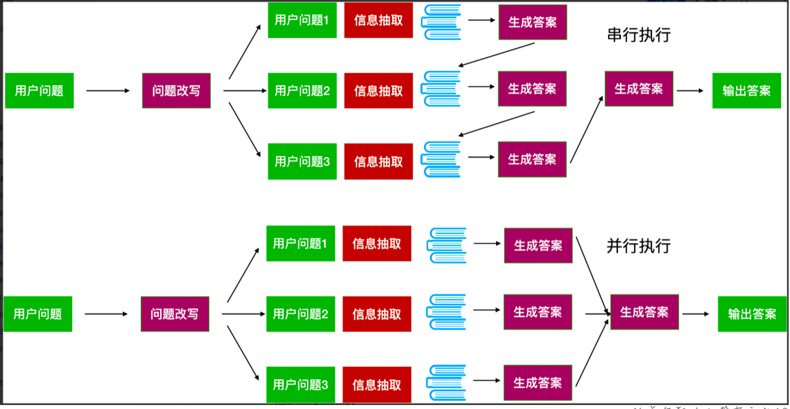
```
#查询优化，问题分解
from langchain_classic.retrievers.multi_query import LineListOutputParser
from langchain_community.vectorstores import Chroma
from langchain_core.documents import Document

from langchain_openai import ChatOpenAI
from langchain_community.embeddings.dashscope import DashScopeEmbeddings

from langchain_core.prompts import ChatPromptTemplate
from langchain_core.retrievers import BaseRetriever
from langchain_core.language_models import BaseLanguageModel
from langchain_core.prompts import PromptTemplate,BasePromptTemplate
from langchain_core.callbacks import  CallbackManagerForRetrieverRun
from typing import List
from langchain_core.documents import Document
from langchain_core.runnables import Runnable,RunnableLambda

from models import  get_ali_clients

#获得访问大模型和嵌入模型客户端
llm,embeddings_model = get_ali_clients()

# 格式化输出内容
def pretty_print_docs(docs):
    print(
        f"\n{'-' * 100}\n".join(
            [f"Document {i+1}:\n\n" + d.page_content for i, d in enumerate(docs)]
        )
    )

documents = [
    Document(page_content="番茄炒蛋的食材：\n\n- 新鲜鸡蛋：3-4个（根据人数调整）\n- 番茄：2-3个中等大小\n- 盐：适量\n- 白糖：一小勺（可选，用于提鲜）\n- 食用油：适量\n- 葱花：少许（可选，用于增香）\n\n这些是最基本的材料，当然也可以根据个人口味添加其他调料或配料。"),
    Document(page_content="番茄炒蛋的步骤：鸡蛋打入碗中，加入少许盐，用筷子或打蛋器充分搅拌均匀；\n   - 番茄洗净后切成小块备用。\n\n3. **炒鸡蛋**：锅内倒入适量食用油加热至温热状态，然后将搅拌好的鸡蛋液缓缓倒入锅中。待鸡蛋凝固时轻轻翻动几下，让其受热均匀直至完全熟透，随后盛出备用。\n\n4. **炒番茄**：在同一锅里留下的底油中放入切好的番茄块，中小火慢慢翻炒至出汁，可根据个人口味加一点点白糖提鲜。\n\n5. **合炒**：当番茄炒至软烂并开始释放大量汤汁时，再把之前炒好的鸡蛋倒回锅里，快速与番茄混合均匀，同时加入适量的盐调味。如果喜欢的话还可以撒上一些葱花增加香气。\n\n6. **完成**：最后检查一下味道是否合适，确认无误后即可关火装盘享用美味的番茄炒蛋啦！"),
    Document(page_content="技巧与注意事项：1. **选材**：选择新鲜的鸡蛋和成熟的番茄。新鲜的食材是做好这道菜的基础。\n2. **打蛋液**：将鸡蛋打入碗中后加入少许盐（根据个人口味调整），然后充分搅拌均匀。这样做可以让蛋更加松软且味道更佳。\n3. **处理番茄**：番茄最好先用开水稍微焯一下皮，然后去皮切块。这样可以去除表皮的硬质部分，让番茄更容易入味，并且口感更好。\n4. **热锅冷油**：先用中小火把锅烧热，再倒入适量食用油，待油温五成热时下蛋液。这样的做法可以使蛋快速凝固形成漂亮的形状而不易粘锅。\n5. **分步烹饪**：通常建议先炒鸡蛋至半熟状态取出备用；接着利用剩下的底油继续翻炒番茄至出汁，最后再将之前炒好的鸡蛋倒回锅里与番茄混合均匀加热即可。\n6. **调味品**：除了基本的盐之外，还可以根据喜好添加少量糖来提鲜或者一点酱油增色添香。注意调味料不宜过多以免掩盖了食材本身的味道。\n7. **出锅前加葱花**：如果喜欢的话，在即将完成时撒上一些葱花不仅能增加菜品色泽还能增添香气。")
]

vectorstore = Chroma.from_documents(documents=documents,
                                    embedding=embeddings_model,
                                    collection_name="decomposition")
# 利用向量数据库检索，设置topk=1
retriever = vectorstore.as_retriever(search_kwargs={"k": 1})

print("-------------检索到的文档（拆解前）--------------")
#从实际来说，该问题的答案应该包括原材料、步骤，以及注意事项才算完整
pretty_print_docs(retriever.invoke("新手如何制作番茄炒蛋？"))


print("开始问题拆解的处理=======================>")
template = """你是一名AI语言模型助理。你的任务是将输入问题分解成3个子问题，通过一个个解决这些子问题从而解决完整的问题。
            子问题需要在矢量数据库中检索相关文档。通过分解用户问题生成子问题，你的目标是帮助用户克服基于距离的相似性搜索的一些局限性。
            请提供这些用换行符分隔的子问题本身，不需要额外内容。
            原始问题: {question}"""
DEFAULT_QUERY_PROMPT =PromptTemplate(
    input_variables=["question"],
    template=template,
)

print("-------------测试大模型对问题的拆解，实际业务中可不用--------------")
#LineListOutputParser() 的作用是将模型输出的文本按换行符分割成字符串列表。
chain = DEFAULT_QUERY_PROMPT | llm | LineListOutputParser()
result = chain.invoke({"question":"新手如何制作番茄炒蛋？"})
print("问题拆解：",result)
print("-------------完成测试大模型对问题的拆解--------------")

DEFAULT_SUB_QUESTION_PROMPT = PromptTemplate(
    input_variables=["question", "sub_question", "documents"],
    template="""要解决主要问题{question}，需要先解决子问题{sub_question}。
    以下是为支持您的推理而提供的参考文档：{documents}。请直接给出当前子问题的答案。不需要额外内容。""",
)

#自定义一个检索器，将对子问题的生成、获得子问题的答案组合起来，通过组合简化使用过程
class DecompositionQueryRetriever(BaseRetriever):
    # 向量数据库检索器
    retriever: BaseRetriever
    # 生成子问题链
    make_sub_chain: Runnable
    # 解决子问题链
    resolve_sub_chain: Runnable

    @classmethod
    def from_llm(
            cls,
            retriever: BaseRetriever,
            llm: BaseLanguageModel,
            prompt: BasePromptTemplate = DEFAULT_QUERY_PROMPT,
            sub_prompt: BasePromptTemplate = DEFAULT_SUB_QUESTION_PROMPT
    ) -> "DecompositionQueryRetriever":
        output_parser = LineListOutputParser()
        # make_sub_chain = prompt | llm | output_parser
        # resolve_sub_chain = sub_prompt | llm
        return cls(
            retriever=retriever,
            make_sub_chain=prompt | llm | output_parser,
            resolve_sub_chain=sub_prompt | llm
        )

    #生成子问题
    def generate_queries(self, question: str) -> List[str]:
        response = self.make_sub_chain.invoke({"question": question})
        lines = response
        print(f"生成子问题: {lines}")
        return lines

    # 获得子问题答案
    def retrieve_documents(self, query: str, sub_queries: List[str]) -> List[Document]:
        sub_llm_chain = RunnableLambda(
            # 传入子问题，检索文档并回答
            lambda sub_query: self.resolve_sub_chain.invoke(
                {
                    "question": query,
                    "sub_question": sub_query,
                    "documents": [doc.page_content for doc in self.retriever.invoke(sub_query)]
                }
            )
        )
        # 批量执行所有的子问题
        responses = sub_llm_chain.batch(sub_queries)
        # 将子问题和答案合并作为解决主问题的文档
        documents = [
            Document(page_content=sub_query + "\n" + response.content)
            for sub_query, response in zip(sub_queries, responses)
        ]
        return documents


    def _get_relevant_documents(
            self,
            query: str,
            *,
            run_manager: CallbackManagerForRetrieverRun,
    ) -> List[Document]:
        # 生成子问题
        sub_queries = self.generate_queries(query)
        # 解决子问题
        documents = self.retrieve_documents(query, sub_queries)
        return documents

print("使用DecompositionQueryRetriever来分解问题------------>")
decompositionQueryRetriever = DecompositionQueryRetriever.from_llm(llm=llm, retriever=retriever)
decomposition_docs = decompositionQueryRetriever.invoke("番茄炒蛋怎么制作？")
print("-------------检索到的文档（拆解后）--------------")
pretty_print_docs(decomposition_docs)

# 创建prompt模板
template = """请根据以下文档回答问题:
### 文档:
{context}
### 问题:
{question}
"""

# 由模板生成prompt
prompt = ChatPromptTemplate.from_template(template)

chain = prompt | llm

print("-------------回答--------------")
question = "新手如何制作番茄炒蛋？"
response = chain.invoke({"context": [doc.page_content for doc in decomposition_docs], "question": question})
print(response.content)
```
#### 查询优化总结：
查询优化：目标是提升用户意图理解的准确性，包括：
- Enrich完善问题：通过大模型引导完善用户问题，产生一个更利于系统理解的完善后的用户问题
- 多路召回（Multi-Query）针对用户问题生成多个相关问题，分别检索后汇总结果
- 问题分解（Decomposition）将复杂问题拆分为多个子问题，依次或同步解决所有子问题从而获取最终答案

### 3、检索优化-混合检索
EnsembleRetriever是Langchain集合多个检索器的检索器。

1. 混合检索的核心价值：
取长补短，动态适配混合检索的

2. 本质是根据数据特性、查询需求和场景约束，动态组合多种检索技术：
- 向量检索擅长捕捉语义相似性，但可能受限于向量空间的表示能力；
- 关键词 / 全文检索适合精确匹配，但对自然语言表达不友好；
- SQL检索利用数据库，却难以应对非结构化文本。

3. 适用场景
- 异构数据场景：处理多类型、多格式数据
- 复杂查询场景：兼顾精确匹配与语义理解
- 动态知识与实时性需求：融合静态知识与实时数据
- 高准确率与召回率要求：医疗、法律等关键领域

4. 基本思路
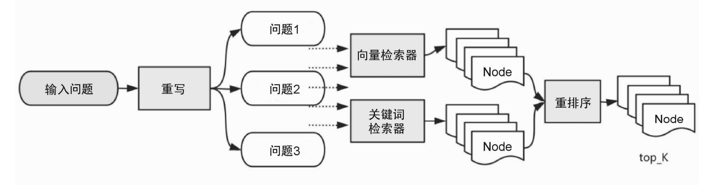

```
from langchain_classic.retrievers import EnsembleRetriever
from langchain_community.document_loaders import TextLoader
from langchain_community.retrievers import BM25Retriever
from langchain_community.vectorstores import Chroma
from langchain_core.output_parsers import StrOutputParser
from langchain_core.prompts import ChatPromptTemplate
from langchain_core.runnables import RunnableMap
from langchain_text_splitters import RecursiveCharacterTextSplitter

from models import get_ali_clients

#获得访问大模型和嵌入模型客户端
llm,embeddings_model = get_ali_clients()

# 格式化输出内容
def pretty_print_docs(docs):
    print(
        f"\n{'-' * 100}\n".join(
            [f"Document {i+1}:\n\n" + d.page_content for i, d in enumerate(docs)]
        )
    )

# 加载文档
loader = TextLoader("./deepseek百度百科.txt",encoding="utf-8")
docs = loader.load()

# 分割文档
text_splitter = RecursiveCharacterTextSplitter(
    chunk_size=512,
    chunk_overlap=50,
)
split_docs = text_splitter.split_documents(docs)

vectorstore = Chroma.from_documents(
    documents=split_docs, embedding=embeddings_model
)

question = "相关评价"

# 向量检索
vector_retriever = vectorstore.as_retriever(search_kwargs={"k": 3})
doc_vector_retriever = vector_retriever.invoke(question)
print("-------------------向量检索-------------------------")
pretty_print_docs(doc_vector_retriever)

# 关键词检索
BM25_retriever = BM25Retriever.from_documents(split_docs)
BM25Retriever.k = 3
doc_BM25Retriever = BM25_retriever.invoke(question)
print("-------------------BM25检索-------------------------")
pretty_print_docs(doc_BM25Retriever)

# 混合检索
#EnsembleRetriever是Langchain集合多个检索器的检索器。
# EnsembleRetriever 归一化内部进行了封装，使用的不是分数归一化        0-1之间的分数   向量检索得分范围0-1
# retrievers 列表，表示检索器列表 归一化RAG Fusion , bm25结果占总数的比重是多少？ 权重进行设置
ensembleRetriever = EnsembleRetriever(retrievers=[BM25_retriever, vector_retriever], weights=[0.5, 0.5])
retriever_doc = ensembleRetriever.invoke(question)
print("-------------------混合检索-------------------------")
print(retriever_doc)

# 创建prompt模板
template = """请根据下面给出的上下文来回答问题:
{context}
问题: {question}
"""

# 由模板生成prompt
prompt = ChatPromptTemplate.from_template(template)

# 创建chain
chain1 = RunnableMap({
    "context": lambda x: ensembleRetriever.invoke(x["question"]),
    "question": lambda x: x["question"]
}) | prompt | llm | StrOutputParser()
chain2 = RunnableMap({
    "context": lambda x: vector_retriever.invoke(x["question"]),
    "question": lambda x: x["question"]
}) | prompt | llm | StrOutputParser()

print("------------模型回复------------------------")
print("------------向量检索+BM25[0.5, 0.5]------------------------")
print(chain1.invoke({"question":question}))
print("------------向量检索------------------------")
print(chain2.invoke({"question":question}))
```

### 4、Post-Retrieval 后检索优化
与检索前处理相对应，这是在完成检索后对检索出的相关知识块做必要补充处理的阶段。比如，对检索的结果借助更专业的排序模型与算法进行重排序或者过滤掉一些不符合条件的知识块等，使得最需要、最合规的知识块处于上下文的最前端，这有助于提高大模型的输出质量。

#### （1）RAG-Fusion 融合
1. 痛点分析
在多个查询检索后，会检索到大量的上下文，但并非所有上下文都与问题相关，有的不相关文档可能出现在文档前面，影响答案生成的准确性

2. 基本思路：
RAG-Fusion 是一种搜索方法，通过使用多重查询生成和互惠排名融合（Reciprocal Rank Fusion）对搜索结果进行重新排序。在Multi Query的基础上，对其检索结果进行重新排序(即reranking)后输出Top K个最相关文档，最后将这top k个文档喂给LLM并生成最终的答案

Reciprocal Rank Fusion（倒数排名融合，RRF）：将多个不同检索的排名列表合并。
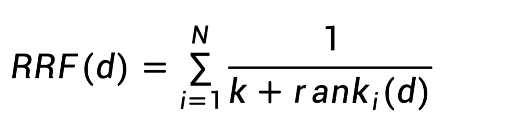

N：参与融合的检索列表数量（例如BM25和向量检索，则N=2；multi−query生成了3个问题，则N=3
rank_i(d)：文档d在第i个检索系统从的排名（从1开始计数）
k：平滑常数，通常设置为60
```
#Post-Retrieval后检索-重排序RAG-Fusion
from langchain_classic import hub
from langchain_community.vectorstores import Chroma
from langchain_core.load import dumps, loads
from langchain_core.output_parsers import StrOutputParser

# from langchain.load import dumps, loads
from langchain_core.runnables import chain

from models import get_ali_clients

#获得访问大模型和嵌入模型客户端
llm,embeddings_model = get_ali_clients()

texts=[
    "人工智能在医疗诊断中的应用。",
    "人工智能如何提升供应链效率。",
    "NBA季后赛最新赛况分析。",
    "传统法式烘焙的五大技巧。",
    "红楼梦人物关系图谱分析。",
    "人工智能在金融风险管理中的应用。",
    "人工智能如何影响未来就业市场。",
    "人工智能在制造业的应用。",
    "今天天气怎么样",
    "人工智能伦理：公平性与透明度。"
]

# 创建向量数据库对象
vectorstore = Chroma.from_texts(
    texts=texts, embedding= embeddings_model
)   

retriever = vectorstore.as_retriever()

#从langchain官网拉取预先定义好的prompt
prompt = hub.pull("langchain-ai/rag-fusion-query-generation")
print(prompt)
#也可以手工定义prompt如下：
# prompt = ChatPromptTemplate.from_messages([
#     ("system", "You are a helpful assistant that generates multiple search queries based on a single input query."),
#     ("user", "Generate multiple search queries related to: {original_query}"),
#     ("user", "OUTPUT (4 queries):")
# ])

# 创建多重查询chain
generate_queries = (
    prompt | llm | StrOutputParser() | (lambda x: x.split("\n"))
)

original_query = "人工智能的应用"
queries = generate_queries.invoke({"original_query": original_query})
print(f"原始查询：{original_query},生成的查询：{queries}")

@chain
def reciprocal_rank_fusion(results: list[list], k=60):
    """互逆排序融合算法，用于合并多个排序文档列表
    Args:
        results: 包含多个排序文档列表的二维列表
        k: 融合公式中的平滑参数（默认60），值越小排名影响越大
    Returns:
        按融合分数降序排列的文档列表，每个元素为(文档对象, 分数)元组
    """
    # 初始化融合分数字典（key=序列化文档，value=累计分数）
    fused_scores = {}

    # 遍历每个检索结果列表（每个查询对应的结果）
    for docs in results:
        # 对当前结果列表中的文档进行遍历（rank从0开始计算）
        for rank, doc in enumerate(docs):
            # 序列化文档对象为字符串（用于唯一标识）
            doc_str = dumps(doc)
            # 初始化文档得分（如果是首次出现）
            if doc_str not in fused_scores:
                fused_scores[doc_str] = 0
            # 计算并累加RRF分数：1 / (当前排名 + k)
            # 排名越靠前（rank值小）的文档获得的分数越高
            fused_scores[doc_str] += 1 / (rank + k)

    # 按融合分数降序排序（分数越高排名越前）
    reranked_results = [
        (loads(doc), score)  # 反序列化还原文档对象
        for doc, score in sorted(fused_scores.items(), 
                               key=lambda x: x[1], 
                               reverse=True)
    ]

    return reranked_results

original_query = "人工智能的应用"
'''
generate_queries会生成4个多角度的query,
retriever.map()的作用是根据generate_queries的结果映射出4个retriever(可以理解为同时复制出4个retriever)
与generate_queries生成的4个query对应，
并为每个query检索出来的一组相关文档集(默认为4个相关文档)，
那么4个query总共可以生成16个相关文档。
最后会经过RRF算法重新排序后输出最相关的文档
'''
chain = generate_queries | retriever.map() | reciprocal_rank_fusion

# 输入结果列表
result_list = chain.invoke({"original_query": original_query})
# 提取文档内容和对应分数
contents = [doc[0].page_content for doc in result_list]
scores = [doc[1] for doc in result_list]

combined_tuples = list(zip(contents, scores))
print("--"*15,"最相关的文档及其得分：")
for item in combined_tuples:
    print(item)

print("--"*15,"分析一下这些分数是如何统计出来的：")
#分析一下这些分数是如何统计出来的
chain1 = generate_queries | retriever.map() 
chain1_result = chain1.invoke({"original_query": original_query})

#原始输出是一个二维列表，每个元素是由4个query生成的Document列表
print(chain1_result)

# 处理输出格式
contents = [doc.page_content 
            for group in chain1_result  # 遍历外层列表
            for doc in group]        # 遍历内层文档列表
print(contents)
```

#### （2）上下文压缩和过滤
1. 痛点分析
我们划分文档块的时候，通常不知道用户的查询，这意味着，与查询最相关的信息可能隐藏在一个包含大量不相关文本的文档中，这样输入给LLM，可能会导致更昂贵的LLM调用和较差的响应。

2. 基本思路：
使用给定查询的上下文来压缩它们，以便只返回相关信息，而不是立即按原样返回检索到的文档

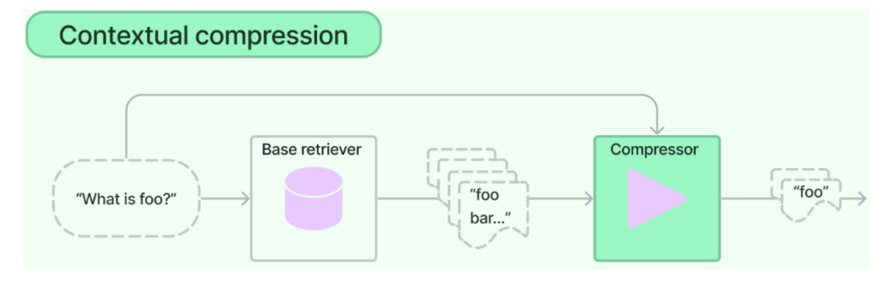

总结：
上下文压缩的目标不是越短越好，而是在不丢答案的前提下，把无关、重复、过长的上下文尽量清掉。
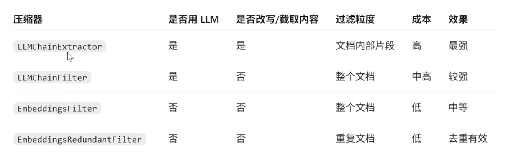