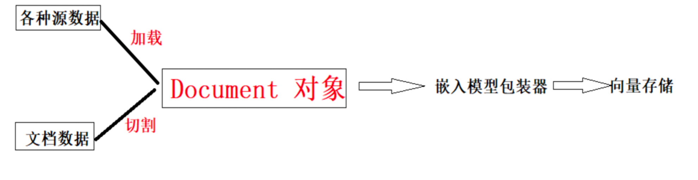
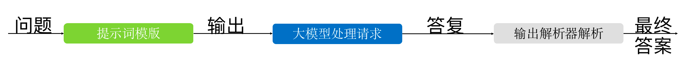
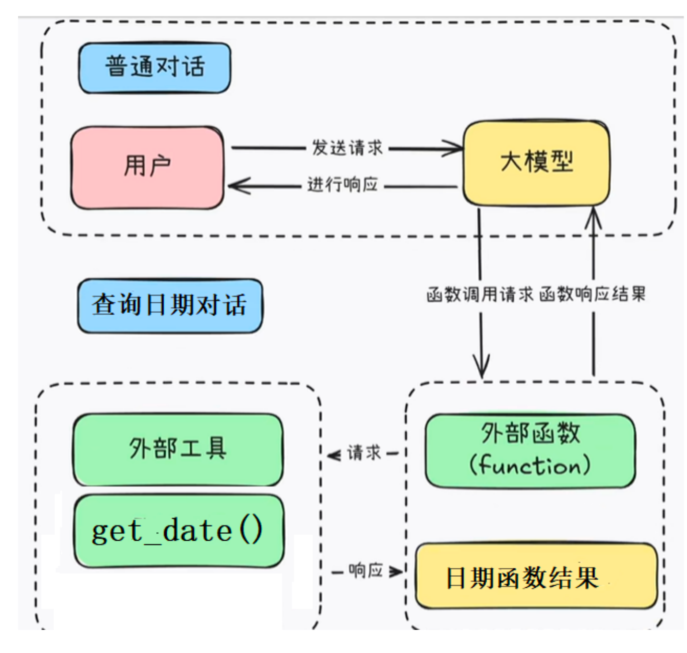
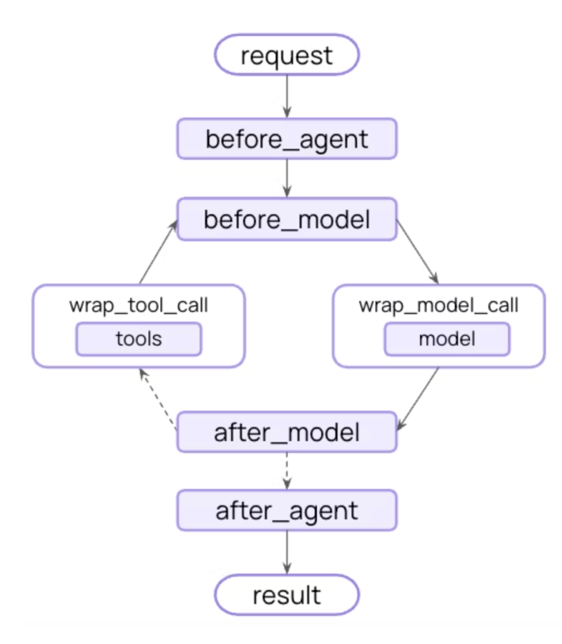

## 一、什么是LangChain V1.0
LangChain是一个用于构建由 LLM 提供支持的代理和应用程序的框架。
作用：简化 LLMs 应用的开发难度，方便开发者快速地开发复杂的 LLMs 应用。

LangChain中组件其实相当多的，大致上可以分为6大部分：
### 1、模型包装器（模型输入/输出（Model I/O））
Models是与语言模型交互的接口。

对于大模型的调用，模型厂商非常多，LangChain屏蔽了底层实现，不管调用哪个模型，它都统一了API。
Models主要包含三部分：提示词、调用模型、输出解析（Parse）
#### （1）调用模型 Language Models
LangChain 提供通用接口调用不同类型的语言模型，这个通用接口被称为模型包装器。LangChain支持的模型有三大类：
1. 非对话模型（LLM）包装器
也叫文本补全模型，接收文本字符串作为输入，并返回一个补全字符串作为输出。
它基于Transformer架构，通过大规模训练数据学习语言规律，适用于文本生成、摘要、翻译、代码生成等任务。
可以理解为只能一问一答。OpenAI的文本补全模型（如GPT-3、text-davinci-003）是通用文本生成工具，而聊天模型（如GPT-3.5 Turbo）是对话专用模型
OpenAI的文本补全类型API在2023年7月进行了最后一次更新，该API现在只能用于访问较旧的历史遗留模型。而且目前国内的大模型厂商普遍对该API也未提供支持。所以该包装器我们不予学习和考虑。
2. 对话聊天模型（Chat Model）包装器
主要代表Open AI的ChatGPT系列模型。这些模型通常由语言模型支持，但它们的API更加结构化。是专门为多轮对话设计的模型，其核心目标是模拟人与AI之间的自然交互。
它基于LLM构建，但通过特定优化（如对话历史管理、角色区分）来提升对话连贯性和上下文理解能力。
聊天模型包装器为 ChatOpenAl，BaseChatModel等
准备工作：
- 参数准备：对应模型的API_KEY，model，base_url等
- 配置好环境变量
```
import os

from langchain.chat_models import init_chat_model
from langchain_community.chat_models import ChatTongyi
from langchain_openai import ChatOpenAI

#1.创建模型客户端,访问基于openai规范的一类模型
# api_key 模型key  model:模型名称  base_url：模型链接的链接地址
# model = ChatOpenAI(api_key=os.getenv("DASHSCOPE_API_KEY"),model="qwen-max",base_url="https://dashscope.aliyuncs.com/compatible-mode/v1")
#1.2 其他方式 ，不是openAI兼容的 查看源码：ctrl+鼠标左击
# model = init_chat_model(model="deepseek-chat" ,model_provider="deepseek" )
#1.3 基于某个平台模型
model = ChatTongyi()
#2.构建提示词，访问模型
prompt = "你是谁？"
result = model.invoke(prompt)
#3.获取打印结果
print(result.content)
```
3. 文本嵌入模型（Embedding Model）
将文本作为输入并返回词向量

#### (2)提示词模版 Prompt Templates
通俗点说，prompt template 是一个模板化的字符串，可以用来生成特定的提示（prompts）。你可以将变量插入到模板中，从而创建出不同的提示。
优势：
    a.清晰易懂的提示
    b.增强可重用性
    c.简化维护
常见提示词模板
    a.LLM提示模板 PromptTemplate：常用的String提示模板
    ```
    from langchain_community.chat_models import ChatTongyi
    from langchain_core.prompts import PromptTemplate

    # 1.创建模型客户端
    model = ChatTongyi()
    #2.构建提示词，访问模型
    # prompt = "你是谁？"
    # 字符串提示词模板 {text}  占位符，通过text变量动态设置提示词内容
    prompt = PromptTemplate(template="你是一个翻译助手，请讲以下内容翻译成{language}:{text}")

    # 输入参数内容，构建真正的提示词
    fact_prompt = prompt.format(language="中文", text="I am a programmer")

    print(fact_prompt)

    result = model.invoke(fact_prompt)
    #3.获取打印结果
    print(result.content)
    ```
    b.聊天提示模板 ChatPromptTemplate： 常用的Chat提示模板，用于组合各种角色的消息模板，传入聊天模型。
    ```
    from langchain_community.chat_models import ChatTongyi
    from langchain_core.prompts import PromptTemplate, ChatPromptTemplate, SystemMessagePromptTemplate, \
        HumanMessagePromptTemplate, AIMessagePromptTemplate

    # 1.创建模型客户端
    model = ChatTongyi()
    #2.构建提示词，访问模型
    # 设置对话提示词模板，设置角色
    prompt = ChatPromptTemplate.from_messages([
        # ("system", "你是一个翻译助手，请将以下内容翻译成{language}"),
        SystemMessagePromptTemplate.from_template("你是一个翻译助手，请将以下内容翻译成{language}"),
        # ("human", "{text}"),
        HumanMessagePromptTemplate.from_template("{text}")
        # AIMessagePromptTemplate  ai的角色消息，用来记录维持对话
    ])


    # 输入参数内容，构建真正的提示词
    fact_prompt = prompt.format(language="中文", text="I am a programmer")

    print(fact_prompt)

    result = model.invoke(fact_prompt)
    #3.获取打印结果
    print(result.content)
    ```
    c.少样本提示模板 FewShotPromptTemplate、提示模板部分格式化、管道提示模板 PipelinePrompt等等。
    ```
    #少样本提示模版的使用
    # from langchain.prompts import PromptTemplate
    # from langchain.prompts.few_shot import FewShotPromptTemplate
    from langchain_community.chat_models import ChatTongyi
    from langchain_core.prompts import PromptTemplate, FewShotPromptTemplate

    from models import get_lc_model_client

    #获得访问大模型客户端
    client = ChatTongyi()

    # 创建示例，模型学习用户给的参照样本，安装样本进行回答
    examples = [
        {"input": "如何重置密码？", "output": "密码重置可以通过绑定邮箱重置密码，也可以通过手机号重置密码"},
        {"input": "我的设备无法开机怎么办？", "output": "故障排除步骤：1.可能是遥控器电池没电，2.确认电源状态，3.确认设备是否被锁屏"},
        {"input": "这款产品是否有夜间模式？", "output": "这款不提供夜间模式，请选择xx款式的产品"},
    ]

    # 配置一个提示模板，用来一个示例格式化
    examples_prompt_tmplt_txt = "用户问题： {input} 对应回答： {output}"

    # 这是一个提示模板的实例，用于设置每个示例的格式
    prompt_sample = PromptTemplate.from_template(examples_prompt_tmplt_txt)

    # 创建少样本示例的对象
    prompt = FewShotPromptTemplate(
        examples=examples,
        example_prompt=prompt_sample,
        prefix="你是一个智能客服, 能够根据用户问题给出答案，",
        suffix="现在给你用户提问: {input} ，请告诉我对应的结果：",
        input_variables=["input"]
    )
    print(prompt.format(input="这款产品有防水模式？"))

    print('-' * 50)

    result = client.invoke(prompt.format(input="这款产品有防水模式？"))
    print(result.content)
    ```
    d.半格式化提示词
    作用这是参数，提前先设置一个参数，后续在设置其他参数，分开给不同参数
    比如：实现学习助手，在提问前先设置学科，在输入内容问题
    ```
    from langchain_community.chat_models import ChatTongyi
    from langchain_core.prompts import PromptTemplate

    # 作用这是参数，提前先设置一个参数，后续在设置其他参数，分开给不同参数赋值
    # 比如：实现学习助手，在提问前先设置学科，在输入内容问题

    # 1.创建模型客户端
    model = ChatTongyi()
    #2.构建提示词，访问模型
    # prompt = "你是谁？"
    # 字符串提示词模板 {text}  占位符，通过text变量动态设置提示词内容
    prompt_txt = "讲一个关于{date}的小故事：{text}"

    prompt = PromptTemplate(template=prompt_txt, input_variables=["date", "text"])

    # 输入参数内容，构建真正的提示词
    half_prompt = prompt.partial(date="2008-08-08")

    print(half_prompt)


    result = model.invoke(half_prompt.format(text="一个幸福的爱情故事"))
    #3.获取打印结果
    print(result.content)

    result = model.invoke(half_prompt.format(text="一个悲伤的爱情故事"))
    #3.获取打印结果
    print(result.content)
    ```
#### (3) 输出解析器 Output Parsers
输出解析器负责获取 LLM 的输出并将其转换为更合适的格式。
有许多不同类型的输出解析器：
1. StrOutputParser
```
from langchain_community.chat_models import ChatTongyi
from langchain_core.output_parsers import StrOutputParser
from langchain_core.prompts import PromptTemplate

# 1.创建模型客户端
model = ChatTongyi()
#2.构建提示词，访问模型
# prompt = "你是谁？"
# 字符串提示词模板 {text}  占位符，通过text变量动态设置提示词内容
prompt = PromptTemplate(template="你是一个翻译助手，请讲以下内容翻译成{language}:{text}")

# 输入参数内容，构建真正的提示词
# fact_prompt = prompt.format(language="中文", text="I am a programmer")
# print(fact_prompt)
parser = StrOutputParser()

#
# result = model.invoke(fact_prompt)
# #3.获取打印结果
# # print(result.content)
# # 4.字符串结果解析器，解析：作用 将大模型返回的内容，获取到字符串内容返回

# str = parser.invoke( result) # 字符串解析
# print(str)
# 链的调用   在langchain中  "|" 是一个链的调用符
chain = prompt | model | parser
result = chain.invoke({"language": "中文", "text": "I am a programmer"})
print(result)
```
2. CSV解析器:CommaSeparatedListOutputParser,模型的输出以逗号分隔，以列表形式返回输出
```
from langchain_community.chat_models import ChatTongyi
from langchain_core.prompts import ChatPromptTemplate
from langchain_core.output_parsers import CommaSeparatedListOutputParser, StrOutputParser
from models import get_lc_model_client

# 获得访问大模型客户端
# client = ChatTongyi();
client = get_lc_model_client()

# 创建解析器
# output_parser = StrOutputParser()
# 将返回结果列表返回，多个值用逗号分隔
output_parser = CommaSeparatedListOutputParser()

# 提示模板
prompt = ChatPromptTemplate.from_messages([
    ("system", "你是一个专业的程序员"),
    ("user", "{input}")
])

# 将提示和模型合并以进行调用
chain = prompt | client | output_parser

# 示例调用
#明确告诉大模型用用逗号分隔返回，我们可以用CommaSeparatedListOutputParser获得内容后以
# 列表的形式获得以进行后续处理，否则返回一个字符串
print(chain.invoke({"input": "列出Python的三个主要版本, 用逗号分隔"}))
print(chain.invoke({"input": "列举三个常见的机器学习框架, 用逗号分隔"}))
```
3. 日期时间解析器:DatetimeOutputParser,可用于将 LLM 输出解析为日期时间格式
```
# 0.3版本的时间解析
# from langchain.output_parsers import DatetimeOutputParser
# 1.0版本的中将原有的API都移入到langchain_classic包中
from langchain_classic.output_parsers import DatetimeOutputParser
from langchain_core.output_parsers import StrOutputParser
from langchain_core.prompts import PromptTemplate

from models import get_lc_model_client

#获得访问大模型客户端
client = get_lc_model_client()

# 定义模板格式
template = """
回答用户的问题：{question}

{format_instructions}
"""

# 使用日期时间解析器
output_parser = DatetimeOutputParser()

prompt = PromptTemplate.from_template(
    template,
    # partial 表示提前先置变量的值
    partial_variables={"format_instructions": output_parser.get_format_instructions()},
)
print(prompt)
print("-"*30)
print(output_parser.get_format_instructions())
print("-"*30)
# 链式调用
chain = prompt | client | output_parser
output = chain.invoke({"question": "新中国是什么时候成立的？"})
# 打印输出
print(output)  # 1949-10-01 00:00:00

# 个性化定制日期格式？ DatetimeOutputParser 不能自定义日期格式

# 执行
# output = model.invoke(prompt.format(question='新中国成立的时间？'))
# datetime_parsed = output_parser.parse(output.content)
# # 打印输出
# print(datetime_parsed)  # 1949-10-01
```
4. JSON解析器:JsonOutputParser,确保输出符合特定JSON对象格式。
```
from langchain_core.prompts import ChatPromptTemplate
# 创建解析器
from langchain_core.output_parsers import JsonOutputParser, StrOutputParser

from models import get_lc_model_client

#获得访问大模型客户端
client = get_lc_model_client()
output_parser = JsonOutputParser()

# 提示模板
prompt = ChatPromptTemplate.from_messages([
    ("system", "你是一个专业的程序员"),
    ("user", "{input}")
])

# 将提示和模型合并以进行调用
chain = prompt | client | output_parser


#明确告诉大模型用JSON格式返回，我们可以用JSONOutputParser获得JSON格式的内容以进行后续处理，否则返回一个字符串
result = chain.invoke({"input": "langchain是什么? 问题用question 回答用ans 返回一个JSON格式"})
print(type(result))
print(result)
# print(chain.invoke({"input": "大模型中的langchain是什么?"}))
```

### 2、数据连接（Data connection）
LangChain中的数据连接组件包括几个关键模块：文档加载、切割、转换、嵌入、向量存储和检索与大模型生成，完成一个基础RAG应用。
#### （1）文档与文档加载
文档类型有很多，可以是简单的文本文件、Word文档、Excel表格、Pdf文件等等。LangChain有很强的数据加载能力，提供了很多常见的数据格式的支持，例如CSV、文件目录、HTML、JSON、Markdown及PDF等。
- TXT文档:TextLoader
- PDF文档:PyPDFLoader
- CSV文档:CSVLoader
- JSON文档:JSONLoader
- HTML文档:UnstructuredHTMLLoader
- MD文档:UnStructuredMarkdownLoader
- 文件目录:DirectoryLoader
加载器有 load方法，用于从指定的数据源读取数据，并将其转换成一个或多个文档。

```
from langchain_community.document_loaders import UnstructuredWordDocumentLoader, Docx2txtLoader

# 1.指定要加载的Word文档路径
loader = Docx2txtLoader("人事管理流程.docx")

# 加载文档、转换格式化成document
documents = loader.load()
```
#### （2）文档转换器-切割
LangChain提供了很多现成的分割器：
- CharacterTextSplitter：基于字符(默认为"\n\n")进行切割，并通过字符数量来测量文本块的大小。使用chunk_size属性可设置文本块的大小，使用chunk_overlap 属性设置文本块之间的最大重叠。
- RecursiveCharacterTextSplitter：  在前面我们已经了解过，除了自然语言，它也支持对特定的编程语言(‘JavaScript’、‘cpp’、‘go’、‘java’ 、‘php’、‘python’等等)的代码进行切割。
- MarkdownHeaderTextSplitter：可以根据指定的一组标题来切割一个Markdown 文档。
- ……….
内置分割器：https://python.langchain.com/api_reference/text_splitters/index.html
```
# 文档切割 递归切割
# separators
text_splitter = RecursiveCharacterTextSplitter(
    chunk_size=500, #切块大小
    chunk_overlap=50,  # 切块重叠大小
    # separators=[".", '\n', '!', '?', ';']
)
# 通过分割器获取document :create_documents   split_documents  传入一个document对象，返回一个document对象列表
split_documents = text_splitter.split_documents(documents)
```
#### （3）文档转换器
LangChain文档转换器处理任务分为两个步骤:
- 第一步是对文档进行切割，主要由切割器完成;
- 第二步是将切割后的文档转换为 Document 对象/数据格式。
LangChain中数据以 Document 对象和向量形式在各个包装器中流通。Document 对象包含文本及其相关元数据，它是LangChain在RAG处理中非常重要的概念。

 

Document中有两个字段：
- page_content：原始文档内容
- meta_data：元数据，文档的描述信息【后面可以根据元数据进行精准查询】

#### (4) 嵌入模型包装器和向量数据库
文本嵌入模型（Embedding Model），这些模型将文本作为输入并返回词向量。
LangChain 框架提供了一个名为Embeddings 的类，它为多种文本嵌入模型(如OpenAI、Cohcre、HuggingFace 等)提供了统一的接口。通过该类实例化的嵌入模型包装器，可以将文档转换为向量数据，同时将搜索的问题也转换为向量数据，这使得可通过计算搜索问题和文档在向量空间中的距离，来寻找在向量空间中最相似的文本。
实例化的 Embeddings 类被称为嵌入模型包装器，同Model I/O 模块的 LLM 模型包装器和聊天模型包装器(Chat Model)并称为三大模型包装器。
```
# 模型包装器：大模型分成三类：LLM  聊天模型  嵌入模型
# 获得一个阿里通义千问嵌入模型的实例，同样在models.py中被包装为get_ali_embeddings()
from langchain_community.embeddings import DashScopeEmbeddings
# 嵌入模型的模型包装器
llm_embeddings = DashScopeEmbeddings(
    # 模型名称
    model=ALI_TONGYI_EMBEDDING_MODEL,
    # API_KEY
    dashscope_api_key=os.getenv(ALI_TONGYI_API_KEY_OS_VAR_NAME)
)

# 实例化向量空间，向量化+向量存储到向量数据库中
vector_store = Chroma.from_documents(documents=split_documents,embedding=llm_embeddings)
```

#### (5) 检索
检索器 (Retriever) 是 RAG (检索增强生成) 系统的核心组件，负责从知识库中查找与用户查询相关的文档片段。
1. 创建 FAISS 检索器
retriever_faiss = FAISS.from_texts(texts, embeddings).as_retriever()
2. 创建 Chroma 检索器
retriever_chroma = Chroma.from_documents(docs, embeddings).as_retriever()
返回的类型是VectorStoreRetriver

检索器对象：检索文档，可以根据需要对检索后的结果做各种处理
VectorStoreRetriver 中 allowed_search_types 参数设置检索方式： 
- similarity：默认，向量相似度检索
- similarity_score_threshold：向量相似度阈值检索
- mmr：max margin relevance，一种平衡相关性和多样性的检索方式 
    步骤：
    （1）从知识库检索出一个候选文档集合
    （2）从候选集中迭代的选择文档，选择一个后，计算边际相关性分数（文档本身与原始查询相似性，与已经选择的结果的相似度高则排序--惩罚冗余，鼓励多样性
    应用场景：1、摘要任务 2、问答系统 3、推荐系统
默认top-k等于4
```
retriever = vector_store.as_retriever()
# retriever = vector_store.as_retriever(
#     search_type="similarity_score_threshold",
#     search_kwargs={
#         "score_threshold": 0.3,
#     }
# )
```
3. 关键词检索器
```
retriever_bm25 = BM25Retriever.from_texts(texts)
```
4. 混合检索器 (结合语义+关键词)
```
ensemble_retriever = EnsembleRetriever(
    retrievers=[retriever_faiss, retriever_bm25],
    weights=[0.7, 0.3]  # 权重分配
)
```

### 3、链（Chains）
#### （1）什么是链
LangChain的名字源自其框架的核心设计思路:用链(Chain)，将大语言模型开发的各个组件链接起来，以构建复杂的应用程序。
链的主要功能是管理应用程序中的数据流动，它将不同的组件(或其他链)链接在一起，形成一个完整的数据处理流程。每个组件都是链中的一个环节，它们按照预设的顺序，接力完成各自的任务，就好比工厂里的流水线。

LCEL 也被称为LangChain表达式(LangChain Expression Language)，是一种用声明式的方法来链接LangChain组件。
所有可以被链起来的组件，如大语言模型、输出解析器、检索器、提示词模板一般都支持下面三个方法：
- stream: 流式返回响应的块
- invoke: 接受输入返回输出
- batch: 接受批量输入返回输出列表
所以最终组成的链在使用上，也是调用这三个方法。

  

1. stream 流式返回
```
from langchain_community.chat_models import ChatTongyi
from langchain_core.output_parsers import StrOutputParser
from langchain_core.prompts import PromptTemplate

#1.模型客户端,streaming对话采样流式输出
model = ChatTongyi(streaming=True)

#2.构建提示词模板
prompt = PromptTemplate(
    input_variables=["topic"],
    template="用5句话来介绍{topic}"
)

#3.结果解析器
out = StrOutputParser()

#4.构建链式调用
chain = prompt | model | out
for chunk in chain.stream({"topic": "人工智能"}):
    print(chunk, end="", flush=True) #flush=True 刷新缓冲区
```
2. invoke 返回
```
from langchain_community.chat_models import ChatTongyi
from langchain_core.output_parsers import StrOutputParser
from langchain_core.prompts import PromptTemplate

# 1.创建模型客户端
model = ChatTongyi()
#2.构建提示词，访问模型
# 字符串提示词模板 {text}  占位符，通过text变量动态设置提示词内容
prompt = PromptTemplate(template="你是一个翻译助手，请讲以下内容翻译成{language}:{text}")

parser = StrOutputParser()

# 链的调用   在langchain中  "|" 是一个链的调用符
chain = prompt | model | parser
result = chain.invoke({"language": "中文", "text": "I am a programmer"})
print(result)
```
3. batch接受批量输入返回输出列表
```
from langchain_community.chat_models import ChatTongyi
from langchain_core.prompts import ChatPromptTemplate
from langchain_openai import ChatOpenAI
from langchain_core.output_parsers import StrOutputParser
import time

# 1. 创建LCEL链
chain = (
    ChatPromptTemplate.from_template("用一句话介绍{topic}")
    | ChatTongyi()
    | StrOutputParser()
)

# 2. 准备批量输入
topics = ["人工智能", "区块链", "量子计算", "基因编辑"]
inputs = [{"topic": topic} for topic in topics]  #[{"topic":value},{"topic":value},...]

# 3. 单次调用计时  串行执行，一个个主题执行
start = time.time()
single_results = [chain.invoke({"topic": topic}) for topic in topics]
single_time = time.time() - start

# 4. 批量调用计时
start = time.time()
# 注意事项
# API供应商可能有批量请求限制（如每分钟请求数）
# 输入列表中的所有字典必须有相同的键结构
# 批量处理不适合有状态的操作（如带记忆的对话链）

batch_results = chain.batch(inputs)  # 关键批量调用方法
batch_time = time.time() - start

# 5. 结果对比
print(f"\n=== 单次调用耗时: {single_time:.2f}s ===")
for i, res in enumerate(single_results):
    print(f"{topics[i]}: {res}")

print(f"\n=== 批量调用耗时: {batch_time:.2f}s (加速 {single_time/batch_time:.1f}x) ===")
for i, res in enumerate(batch_results):
    print(f"{topics[i]}: {res}")
```

#### （2）如何组合链
1. 管道操作符 “ | ”
```
chain = prompt | model | parser
result = chain.invoke({"language": "中文", "text": "I am a programmer"})
```
2. 使用RunnableSequence
```
chain = RunnableSequence(prompt, model, parser)
result = chain.invoke({"language": "中文", "text": "I am a programmer"})
```

#### (3) LCEL高级特性与组件
1. RunnableLambda
很多的时候LangChain组件未提供的功能，需要我们自己写函数实现，但是这个函数我们也需要把它加入链，作为工作流程的一部分，此时就需要使用RunnableLambda
```
from operator import itemgetter

from langchain_community.chat_models import ChatTongyi
from langchain_core.output_parsers import StrOutputParser
from langchain_core.prompts import ChatPromptTemplate
from langchain_core.runnables import RunnableLambda, chain


# 1.提供自定义函数
# 输入字符串，返回字符串长度
def length_function(text):
    return len(text)

#将两个字符串长度的数量相乘
def _multiple_length_function(text1, text2):
    return len(text1) * len(text2)


# 输入字典类型，返回字符串长度的乘积
# 方式二：装饰器的方式
@chain
def multiple_length_function(_dict):
    return _multiple_length_function(_dict["text1"], _dict["text2"])

prompt = ChatPromptTemplate.from_template("{a} + {b} = ? 计算结果是多少？")
model = ChatTongyi()
out = StrOutputParser()

# 1.通过链来计算字符串的长度
# chain = length_function("hello")  普通函数调用
# chain = RunnableLambda(length_function)
# # 调用执行链
# print(chain.invoke("hello"))

# 2.通过大模型计算两个字符串的长度的和

# chain = (
#         {"a":itemgetter("k1")| RunnableLambda(length_function) ,
#          "b":itemgetter("k2")| RunnableLambda(length_function) }
#         |prompt | model | out)
#
# print(chain.invoke({"k1": "hello", "k2": "world"}))

# chain = (
#         {"a":itemgetter("k1")| RunnableLambda(length_function) ,  #5
#          # {"text1":"hello","text2":"world"}
#          #  b=25
#          "b":({"text1":itemgetter("k1"),"text2":itemgetter("k2")}|RunnableLambda(multiple_length_function)    ) }
#         |prompt | model | out)
#
# print(chain.invoke({"k1": "hello", "k2": "world"}))


# 测试装饰器
chain = (
        {"a":itemgetter("k1")| RunnableLambda(length_function) ,  #5
         # {"text1":"hello","text2":"world"}
         #  b=25
         "b":({"text1":itemgetter("k1"),"text2":itemgetter("k2")}|multiple_length_function   ) }
        |prompt | model | out)

print(chain.invoke({"k1": "hello", "k2": "world"}))
```
如果函数已经定义好了，就用RunnableLambda包装。如果是新增的或频繁在链中调用，用装饰器@chain

2. RunnableParallel/ RunnableMap
把组件链起来，前面我们使用了RunnableSequence。Sequence的中文意思“顺序，一连串”，也就是所有的组件或多个任务都是按顺序一个个执行的。
但是有时候，我们希望多个任务能够同时执行，这时可以使用RunnableParallel / RunnableMap
```
from langchain_core.globals import set_debug
from langchain_core.runnables import RunnableParallel, RunnableMap, RunnableLambda

set_debug( True)
def add_one(x: int) -> int:
    return x + 1

def mul_two(x: int) -> int:
    return x * 2

def mul_three(x: int) -> int:
    return x * 3

# 测试parallel并行执行
# 同时执行三个函数，输出结果以字段的形式返回{a=2,b=2,c=3}
# chain = RunnableParallel(
#     a=add_one,
#     b=mul_two,
#     c=mul_three,
# )

chain = RunnableMap(
    a=add_one,
    b=mul_two,
    c=mul_three,
)
# 调用链
print(chain.invoke(1)) #{a=2,b=2,c=3}

chain1 = RunnableLambda(add_one)


chain2 = chain1|RunnableParallel(
    a = mul_two,
    b = mul_three,
)

print(chain2.invoke(2))
```

3. RunnablePassthrough
RunnablePassthrough类允许我们在LangChain的链中传递数据：
- 确保数据保持不变，直接用于后续步骤的输入。 RunnablePassthrough常用在链的第一个位置，用于接收用户的输入（也可以用在中间位置，则用于接收上一步的输出）。
- RunnablePassthrough也允许通过assign对数据增强后，再往后传。
它会创建一个新的字典，包含原始的所有字段以及你新指定的字段
```
from langchain_core.runnables import RunnableParallel, RunnablePassthrough

# 原样进行数据传递

# chain = RunnableParallel(
#     passed = RunnablePassthrough(),
# )

# 数据增强，增强后进行继续传递
chain = RunnableParallel(
    passed = RunnablePassthrough().assign(modified= lambda x: x["k1"]+"!!!"),
)

# 调用链
# print(chain.invoke(("hello world")))

# 增强调用，需要使用字典格式
print(chain.invoke({"k1": "hello world"}))
```

#### (4) 预定义链
LangChain已经事先做好了很多LCEL链，可以到LangChain官方API查询：
https://reference.langchain.com/python/langchain_classic/chains/
但是注意：在“Deprecated classes”和“Deprecated functions”中的属于被声明废弃，不建议使用。

例如：create_stuff_documents_chain：将多个文档内容合并成一个长文本，然后一次性交给LLM处理

### 4、记忆（Memory）
用于链的多次运行之间持久化应用程序状态。

大模型是无状态的，也就是大模型是记不住我们聊天中每次的对话内容的。
早期LangChain中有ConversationBufferMemory之类的记忆组件，现在这些组件已经被声明为废弃。

新版本的LangChain提供了专门的消息历史组件ChatMessageHistory和自动会话历史管理组件RunnableWithMessageHistory
1. ChatMessageHistory
- add_user_message() 添加用户的输入信息
- add_ai_message()添加存储大模型的回复信息
- .messages 属性获取所有历史消息
```
#消息历史组件ChatMessageHistory的使用

from langchain_core.output_parsers import StrOutputParser
from langchain_core.prompts import ChatPromptTemplate, SystemMessagePromptTemplate, MessagesPlaceholder, \
    HumanMessagePromptTemplate
from langchain_openai import ChatOpenAI
from langchain_community.chat_message_histories import ChatMessageHistory
import sys
from pathlib import Path

from models import  get_ali_model_client

chat_template = ChatPromptTemplate.from_messages(
    [
        SystemMessagePromptTemplate.from_template("你是人工智能助手"),
        # 作用就是向提示词中插入一段上下文消息
        # ("placeholder", "{messages}"),
        MessagesPlaceholder(variable_name="messages"),  #QA QA
        # HumanMessagePromptTemplate.from_template("{input}"),
    ]
)

client = get_ali_model_client()

parser = StrOutputParser()
chain =  chat_template | client | parser

#  创建消息历史记录，存储组件
chat_history = ChatMessageHistory()

# add_user_message() 添加用户的输入信息
# add_ai_message() 添加存储大模型的回复信息
# .messages 属性获取所有历史消息

while True:
    user_input = input("用户：")
    if user_input == "exit":
        break

    # 添加用户输入
    chat_history.add_user_message(user_input)
    # 访问LLM时，chat_history.messages 获取所有的历史消息
    response = chain.invoke({'messages': chat_history.messages})

    print("chat_history:",chat_history.messages)
    print(f"大模型回复》》》：{response}")

    # 将大模型的回复加入历史记录
    chat_history.add_ai_message(response)
```

 默认是在内存中存储，那怎么长久保存？记忆持久化，存储在redis数据库中。

 ```
from langchain_community.chat_message_histories import RedisChatMessageHistory
from models import get_lc_model_client
# pip install redis
# session_id 识别用户   0.3版本中 redis_url 访问路径
# history = RedisChatMessageHistory(session_id="my_session_id", redis_url="redis://localhost:6379")
# langchain 1.0  url
history = RedisChatMessageHistory(session_id="my_session_id1", url="redis://localhost:6379")


# history.clear()  清空历史消息

client = get_lc_model_client()
# # 第一次对话
# history.add_user_message("你是谁？")
# aimessage = client.invoke(history.messages)
# history.add_ai_message(aimessage)
# print(aimessage)
# print("==================")
# 第二次对话
history.add_user_message("重复一次")
print(history.messages)
aimessage = client.invoke(history.messages)
history.add_ai_message(aimessage)
print(aimessage)
```
2. RunnableWithMessageHistory 记忆自动化管理

### 5、代理（Agents）与工具
扩展模型的推理能力，用于复杂的应用的调用序列。
大模型中工具使用 Function Call

LangChain的工具调用流程:
 

#### （1）自定义工具调用
工具的定义要素：
- 工具的名称
- 工具的描述
- 该工具接收的参数
要调用的函数，工具返回结果
1. 方式一：@tool
```
import datetime
import os

from dashscope import api_key
from langchain.agents import create_agent

from langchain_openai import ChatOpenAI
from langchain.chat_models import  init_chat_model
from langchain_core.prompts import  PromptTemplate
# from langchain_core.tools import tool
from langchain.tools import tool


# api_key  秘钥  model：模型名称 base_url：模型连接的url地址
model = ChatOpenAI(api_key=os.getenv("DASHSCOPE_API_KEY"), model="qwen-max", base_url="https://dashscope.aliyuncs.com/compatible-mode/v1")

# 注意：函数的描述必须写在函数体中的第一行
@tool
def get_date():
    """ 获取今天的具体日期 """
    # """ 获取今天的北京的天气 """
    return datetime.date.today().strftime("%Y-%m-%d")


import webbrowser
@tool
def open_browser(url, browser_name=None):
    """ 获取浏览器，打开网站 """
    if browser_name:
        # 获取特定浏览器的控制器
        browser = webbrowser.get(browser_name)
    else:
        # 使用默认浏览器
        browser = webbrowser
    # 打开浏览器并导航到指定的URL
    browser.open(url)

# 大模型客户端绑定工具
agent = create_agent(
    model,
    tools=[get_date, open_browser],
)
# 执行agent
# result = agent.invoke({"messages":[{"role":"user","content":"帮我打开淘宝"}]})
# result = agent.invoke({"messages":[{"role":"user","content":"今天是几月几号？"}]})
# 获取北京的今天的天气
result = agent.invoke({"messages":[{"role":"user","content":"帮我打开淘宝"}]})
print( result)
```
2. 方式二：
```
def open_calc(input: str = "") -> str:
    """打开计算器"""
    try:
        subprocess.Popen(['calc.exe'])
        return "计算器已打开"
    except Exception as e:
        return f"打开计算器失败: {str(e)}"
        
tools = [
    # 通过Tool来描述声明工具 name 工具名称 func 函数体 description 函数的功能描述
    Tool(
        name="get_current_time", #可以随意，但是建议跟函数名称一致
        func=get_current_time,
        # 函数的功能描述，说明书
        description="当你想知道现在的时间时非常有用。"
    ),
    Tool(
        name="recom_drink",
        func=recom_drink,
        description="用户口渴，为其推荐附近的饮品店"
    ),
    Tool(
        name="open_calc",
        func=open_calc,
        description="打开本地计算机上的计算器。"
    ),
    Tool(
        name="open_browser",
        func=lambda url: open_browser(url),
        description="打开本地计算机上的网页浏览器，并接受网站的url作为参数。"
    )
]
```
#### （2）预定义工具调用
LangChain 允许用户自定义Tools组件以满足特定的需求。
同时也提供了一组预定义的Tools 组件，Toolkits 组件是一个特殊的组件集合，它包括了多个用于实现特定目标的 Tools组件，LangChain 提供了预定义的 Toolkits 组件。
例如：
Arxiv是一个用于检索学术论文的工具，它让Agent能够搜索和获取科学文献

tips:
如果场景是确定的，并不需要大模型来决定是否使用工具，直接在链中加入工具即可。
但是如果需要大模型来决定是否使用工具，比如场景是动态的或者是以工具组的形式提供工具，那么需要使用Function Call

### 6、中间件（Middleware）
控制和自定义每个步骤的代理执行
#### （1）什么是中间件Middleware
是一种细粒度流程控制机制，用于在智能体执行过程中拦截、修改或增强请求与响应的处理逻辑，而无需修改核心 Agent 或工具的代码。
中间件在每个步骤之前和之后都会暴露钩子（函数）。

类似AOP切面编程思想

  

#### （2）中间件Middleware能做什么
1. 监视器：通过日志记录、分析和调试来跟踪代理行为
2. 调整：转换提示、工具选择和输出格式
3. 控制：添加重试、回退和提前终止逻辑
4. 执行：应用速率限制、防护措施和个人身份信息检测

#### （3）常用的中间件
SummarizationMiddleware 总结摘要中间件（上下文压缩）：当接近会话次数上限时，自动汇总对话历史记录。
```
from langchain.agents import create_agent
from langchain.agents.middleware import SummarizationMiddleware, HumanInTheLoopMiddleware
from langchain_core.messages import HumanMessage
from langchain_core.tools import tool
from langgraph.checkpoint.memory import InMemorySaver

from models import *

# Middleware 中间件
# 添加中间件的方式：在create_agent
'''
agent = create_agent(
    model=qwen_model,
    tools=[],
    middleware=[SummarizationMiddleware(), HumanInTheLoopMiddleware()],
)
'''

# 内置中间件
#   LangChain 为常见用例提供预构建的中间件：

# SummarizationMiddleware : 总结摘要的中间件
#       当接近会话次数上限时，自动汇总对话历史记录。
#  非常适合：
#     - 持续时间过长的对话超出了上下文窗口。
#     - 多轮对话，历史悠久
#     - 在需要保留完整对话上下文的应用中
from langchain.agents import create_agent
from langchain.agents.middleware import SummarizationMiddleware

llm = ChatOpenAI(
    openai_api_base="https://dashscope.aliyuncs.com/compatible-mode/v1",
    openai_api_key=os.getenv("DASHSCOPE_API_KEY"),
    model_name="qwen-max"
)
# 创建短期记忆实例
memory = InMemorySaver()
agent = create_agent(
    model=llm,
    tools=[],
    checkpointer=memory,
    # 中间件列表，可以多个，多个顺序执行
    middleware=[
        SummarizationMiddleware(
            model=llm,
            max_tokens_before_summary=80,  # 80个token 会触发 摘要总结
            messages_to_keep=1,  # 在总结后保留最后1条消息
            # 可选 summary_prompt=" 可以自定义进行摘要的提示词...",
            summary_prompt="请将以下对话历史进行简洁的摘要，保留关键信息: {messages}"
        ),
    ],
    # 打印Agent执行的过程日志
    debug= True
)

# 单一条件:当tokens> = 4000且消息> = 10时触发
# agent = create_agent(
#     model=llm,
#     tools=[weather_tool, add_tool],
#     middleware=[
#         SummarizationMiddleware(
#             model=llm_other,
#             trigger={"tokens": 4000, "messages": 10},
#             keep={"messages": 20},
#         ),
#     ],
# )
#
# # 多重条件-（任意条件必须满足 - 逻辑“或”）。
# agent2 = create_agent(
#     model="gpt-4o",
#     tools=[weather_tool, add_tool],
#     middleware=[
#         SummarizationMiddleware(
#             model="gpt-4o-mini",
#             trigger=[
#                 {"tokens": 5000, "messages": 3},
#                 {"tokens": 3000, "messages": 6},
#             ],
#             keep={"messages": 20},
#         ),
#     ],
# )

# 模拟长对话触发摘要
print("\n模拟长对话场景...")
demo_messages = [
    "用户询问你是谁",
    "用户计算商品价格：数量10，单价25.5",
    "用户再次询问你能做什么？",
    "用户想要生成一个介绍湖南的文案，要求100字左右，包含三湘四水，人文历史",
    "用户继续询问更多GPU产品信息",
    "用户要求计算2*20"
]

for i, message in enumerate(demo_messages, 1):
    print(f"\n💬 第{i}轮对话: {message}")
    # 循环调用Agent，模拟多轮对话
    result = agent.invoke({
        "messages": [HumanMessage(content=message)]},
        config={"configurable": {"thread_id": "testsummarizationMiddleware"}}
    )
    # print("执行结果："+result)
```

#### （4）自定义中间件Middleware
自定义Middleware提供了两种拦截Agent执行的钩子：
1. Node-style hooks Node 风格的钩子
- before_agent - 在Agent启动之前（每次调用一次）
- before_model - 每次模型调用之前。
- after_model - 每次模型响应之后。
- after_agent - Agent完成后（每次调用一次）。

2. Wrap-style hooks 缠绕式钩子
- wrap_model_call - 围绕每次模型调用
- wrap_tool_call - 围绕每次工具调用。

通过在代理执行流程的特定点运行钩子来构建自定义中间件。
- 基于装饰器的：适用于单钩中间件的快速简便
- 基于类的：对于具有多个钩子的复杂中间件来说功能更强大

#### （5）自定义脱敏中间件
```
import os
from dotenv import load_dotenv
# 验证模型连接
from langchain_core.messages import HumanMessage
from langchain_openai import ChatOpenAI

llm = ChatOpenAI(api_key=os.getenv("DASHSCOPE_API_KEY"), model="qwen-max",base_url="https://dashscope.aliyuncs.com/compatible-mode/v1")

# 创建自定义脱敏中间件
from langchain.agents.middleware import AgentMiddleware
from typing import Any, Dict
import re
# 自定义中间件，中间件实现脱敏的，去除电话号码和邮箱信息
class DesensitizeDataMiddleware(AgentMiddleware):
    """脱敏中间件"""

    def __init__(self, patterns: list = None):
        super().__init__()
        self.patterns = patterns or [
            (r'[a-zA-Z0-9_.+-]+@[a-zA-Z0-9-]+\.[a-zA-Z0-9-.]+', '[EMAIL]'),
            (r'(\+86)?1[3-9]\d{9}', '[PHONE]')
        ]

    def _desensitize_text(self, text: str) -> str:
        # 如果内容为空或已经包含脱敏标记，则跳过处理
        if not text or '[EMAIL]' in text or '[PHONE]' in text:
            return text
        # 快速预检查：只有当可能包含敏感信息时才继续处理
        if '@' not in text and not re.search(r'1[3-9]\d{9}', text):
            return text
        print(f"脱敏前: {text}")
        original_text = text
        for pattern, replacement in self.patterns:
            text = re.sub(pattern, replacement, text)
        # 只有当内容发生变化时才打印
        if original_text != text:
            print(f"脱敏后: {text}")
        return text

    def before_model(self, state: Dict[str, Any]) -> Dict[str, Any]:
        """在模型调用前处理"""
        print("中间件DesensitizeDataMiddleware - before_model 被调用")
        if 'messages' in state:
            messages = state['messages']
            processed_any = False
            for message in messages:
                if hasattr(message, 'content') and isinstance(message.content, str):
                    # 只处理非空内容且未被脱敏的内容
                    if message.content and '[EMAIL]' not in message.content and '[PHONE]' not in message.content:
                        # 快速预检查：只有当可能包含敏感信息时才继续处理
                        if '@' in message.content or re.search(r'1[3-9]\d{9}', message.content):
                            # 只有在真正需要处理时才打印日志
                            if not processed_any:
                                print("进行脱敏处理.....")
                            original_content = message.content
                            message.content = self._desensitize_text(message.content)
                            # 只有当内容发生变化时才打印
                            if original_content != message.content:
                                print(f"消息内容已从 '{original_content}' 修改为 '{message.content}'")
                                processed_any = True
            if processed_any:
                print("脱敏处理完成！")
        return state

    def after_model(self, state: Dict[str, Any]) -> Dict[str, Any]:
        """在模型调用后处理"""
        # 只有在真正处理了内容时才打印
        # 这里可以添加后处理逻辑
        return state

# 创建修复后的中间件
desed_middleware = DesensitizeDataMiddleware()

# ===== 测试中间件功能 =====

print("\n" + "=" * 50)
print("开始测试中间件功能")
print("=" * 50)

try:
    # 导入必要的组件
    from langchain_community.agent_toolkits.load_tools import load_tools
    from langgraph.checkpoint.memory import InMemorySaver
    from langchain.agents import create_agent

    # 导入工具，load_tools支持的工具可以在load_tools.py中查看
    tools = load_tools(["arxiv"])

    # 创建短期记忆实例
    memory = InMemorySaver()

    # 系统提示词设计
    system_prompt = "你是一个专业的论文查询助手，使用arxiv工具为用户查询论文信息，回答需简洁准确，包含论文标题、作者、发表时间和核心摘要。"

    # 创建带中间件的Agent
    agent_with_middleware = create_agent(
        model=llm,
        tools=tools,
        system_prompt=system_prompt,
        checkpointer=memory,
        # 加入脱敏的中间件
        middleware=[desed_middleware]
    )

    # 测试---
    # 测试: 包含电子邮件的输入
    print("测试: 电子邮件脱敏")
    email_input = "我的邮箱是test.user@example.com，请帮我查询论文1605.08386"
    print(f"输入内容: {email_input}")

    result1 = agent_with_middleware.invoke(
        {"messages": [{"role": "user", "content": email_input}]},
        config={"configurable": {"thread_id": "middleware_test_1"}}
    )
    print("结果:", result1["messages"][-1].content)

except Exception as e:
    print(f"中间件版本仍然失败: {e}")
```