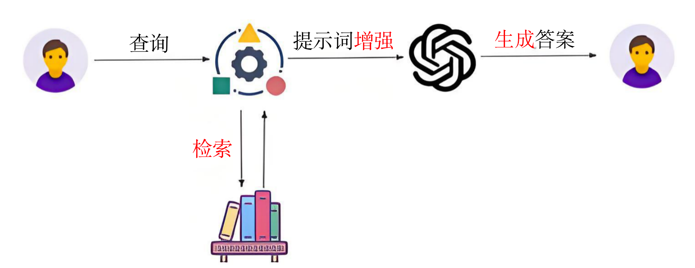
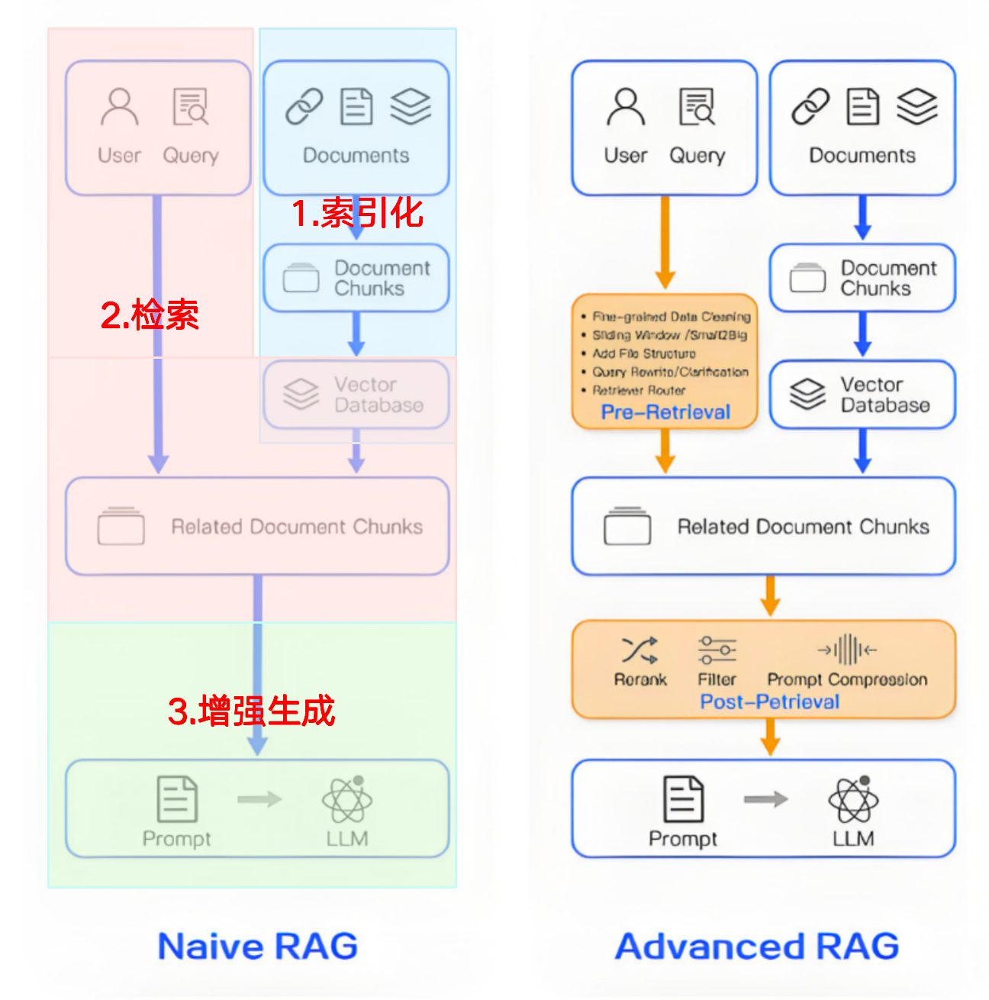
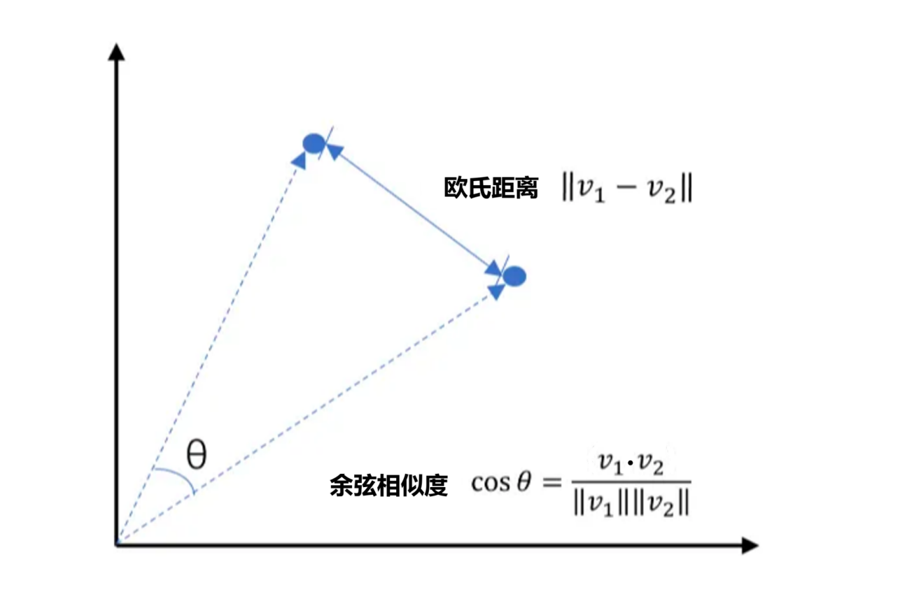
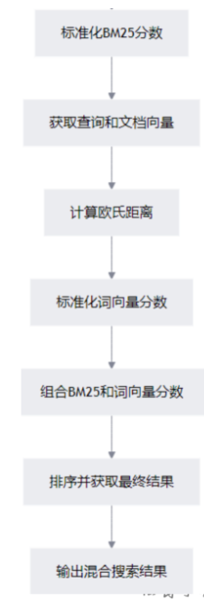

## 一、RAG-检索增强生成
### 1、为什么需要RAG
目前大语言模型本身存在一些局限性，因为大模型都是预训练出来的。
1.时效性：大模型无法询问最新的时事，比如问LLM：“抗战胜利80周年阅兵展示了哪些武器？”
2.知识覆盖度：虽然大模型的训练数据集非常庞大，但仍可能无法涵盖所有领域的知识或特定领域的深度信息。
3.幻觉问题：大模型LLM在某些情况（提问方式不对、模型知识欠缺）下给出的回答很可能错误的，或者是涉及虚构甚至是故意欺骗的信息，这种回答被称之为AI幻觉，亦即大模型一本正经的胡说八道。

目前解决知识更新缓慢和幻觉问题方案有：RAG和微调
1. 大模型微调（Fine-Tuning）
微调是在通用大模型的基础上，针对超出其范围或不擅长的特定领域或任务，使用专门的数据集或方法对模型进行相应的调整和优化，以提升其在该特定领域或任务中的适用性和性能表现。

微调比RAG的成本高很多。

2. RAG
是一种外挂知识库的方式，实现成本和复杂度都比微调更低，且RAG在知识库更新方面表现最佳。

3. RAG和微调对比
    - RAG在知识更新方面表现最佳，因为它可以实时访问最新的数据源
    - 微调需要定期重新训练模型才能纳入新知识

4. tips:
实际中，可以先用RAG，不管是数据清洗、数据分块、测评级构建进行沉淀，等系统运行很稳定了，把RAG中用的知识按照评测级的标准、按照使用构建成训练数据，进行微调。

### 2、什么是RAG
RAG (Retrieval Augmented Generation/检索增强生成) 是一种结合了检索和生成两种方法的技术。它通过先检索相关的文档，用检索出来的信息对提示词增强，再使用大模型生成答案
RAG的本质是： RAG = 大模型LLM + 外部数据


1. RAG：检索增强生成，是一项用来解决大模型知识不足的工程解决方案，并不等同于基于向量的RAG。
检索：检索方式可以很多
- 基于向量检索    ----> Naive RAG 占比还是最高的
- 基于全文检索
- 基于关键字检索
- 基于PageIndex检索
- 基于知识图谱检索
- 基于文档结构wiki检索
- 基于互联网检索

2. RAG的更新问题：
- 全量更新
- 增量更新：
    a.基于文件名
    b.基于文档的前N个字符进行判断（判断文件是否有变化）
    c.基于哈希算法来判断（对文档内容进行md5摘要算法）

## 二、通过FastGPT 了解RAG
### 1、FastGPT 
基于LLM大模型的开源 AI知识库构建平台。提供了开箱即用的数据处理、模型调用、RAG检索、可视化AI工作流编排等能力，帮助您轻松构建复杂的AI应用。
### 2、操作
访问：https://tryfastgpt.ai/ 点击主页面上的“开始使用”，跳转到登录页面，新用户使用邮箱注册之后，就登录成功了
（如果访问速度慢，则使用国内版：https://fastgpt.cn/zh）
FastGPT 3步走：
1. 创建知识库
2. 创建Agent
3. 对话调试

### 3、使用场景：高速验证，低速开发

## 三、Naive RAG 
构建过程主要有三个步骤：
1. 索引化：文档-->分块-->向量化-->存储
2. 检索：用户提问-->向量化-->检索数据库-->得到top K个相关文档块
3. 增强生成：增强提示词（原始问题+相关文档块）--> LLM --> 生成答案


### 1、清洗
数据清洗的目的最终是为了提供质量高的数据来构建知识库。
一般来说，清洗分为以下几种：
1. 通用层面的清洗：格式的转换、标签、页眉页脚、空格的合并等。
PS：通常来说，现在主流的这些文档读写的工具（文档加载器）都提供了类似的功能。
2. 业务层面：
    a.数据的增强
        i.数据的不清晰，需要人工介入来增强。
        ii.内容的补足，常见比如代词指定不明，用户和文档的对齐等。
    b.业务层面的清洗
3. 脱敏处理
4. 血缘的追踪之类。

如果文档多，工作原则：
- 随机或者根据分类去随机抽样。
- 把全流程跑通，提取问题。
- 根据文档多情况，去对文档分类、批量构建清洗规则。（十之八九都是基于正则）
- 对于一些少量的文件，执行人工清洗、分块。

### 2、切片（分块）
#### （1）为什么要分块？
- 从业务角度来说，用户的某一个问题不会需要用到所有或者一个文档的全部内容。
- 从向量模型和大模型的上下文窗口的限制角度来说，技术上是需要 进行分块处理。
#### （2）分块方式
- 基础：固定字符、带重叠窗口、基于句子、递归
- 高级：按结构分块、按对话进行分块、按语义进行分块、自定义分块（基于业务）

实际落地过程中、这些分块方式没有优劣之分，很多时候都是需要根据业务的实际情况进行混合使用。

分块方式：
1. 固定字符数切分：
- 优点：简单、直接、效率高、后续的向量化、大模型检索等都是长度可控。
- 缺点：语义不完整。
2. 固定字符数+重叠窗口：
- ·优点：兼顾固定字符数切分的优点，同时又能最大程度去保留语义的完整性。
- ·缺点：增加存储的开销。
重叠窗口的大小会影响到效果。
太小：没有办法保持语义，太大：浪费的同时会引入噪音。
3. 按句子进行切分：
- ·优点：在自然语言中，一句话一般都代表一个完整的语义部分。
- ·缺点：分得太细，且在自然语言中，上下文也很重要。
4. 递归分块：
- ·优点：综合了上述三种分法的优点
- ·缺点：对于特定业务不够适用。


### 3、向量化
#### （1）Embedding 向量化
1. Naive RAG 是基于向量检索的方式来检索外部知识的。
2. 向量检索方式：根据用户的输入，与向量数据库中存放的文本向量进行相似度计算匹配，并检索返回最为相似的内容。
3. 向量间的相似度计算：
    - 余弦相似度Cosine：基于两个向量夹角的余弦值来衡量相似度。【值范围-1～1，完全相似是1】
    - 欧式距离L2：通过计算向量之间的欧几里得距离来衡量相似度。
    - 点积：计算两个向量的点积，适合归一化后的向量。
    
因此，我们需要将自然语言（查询、文档块）先转换为向量，才能计算相似度，进行向量检索，从而实现检索的过程。

4. 常见的向量检索算法：
    - TF-IVF
    - PG
    - HNSW 
    - DiskANN

#### （2）向量模型
1. 向量模型：又叫嵌入模型，又叫Embedding model，也是通过训练（绝大部份都是基于Transformer架构）的方式得到。
工作方式和普通的大模型不一样
    LLM：用户输入，回答问题。自然语言进，自然语言出。
    向量模型：用户输入，生成输入的向量。自然语言进，向量出。
    PS：不论输入多少内容，一个完整的内容对应一个向量。

2. 在线向量模型
问题：有时向量数据库已经构建好了，但是不同时间通过向量模型生成的值不一样。

3. 向量模型本地部署
（1）Oilama
多大模型都可以本地部署，部署的方式有很多种，最方便的，就是借助Ollama。
Ollama 是一个开源框架，专为在本地机器上便捷部署和运行大模型而设计。
https://ollama.com/ 
（2）BGE-M3 中文为主 或nomic-embed-text-v2-moe 英文
BGE-M3是北京智源人工智能研究院(BAAI)开发的一款多语言、多功能的文本嵌入模型，属于BGE(BAAI General Embedding)系列的最新成员。
BGE-M3 是很多企业常用的比较优秀的文本嵌入模型:
- 多功能性：可以同时实现嵌入模型常用的检索功能。
- 多语言：支持100多种工作语言。
- 多粒度：它能够处理不同粒度的输入，从短句子到多达8192个token的长文档。

#### （3）向量数据库
1. 存储 ：知识转化为向量后，由向量数据库来存储。
2. 在人工智能时代，向量数据库已成为数据管理和AI模型不可或缺的一部分。向量数据库是一种专门设计用来存储和查询向量嵌入数据的数据库。
主流向量数据库：
- 国内开源的：chroma、milvus、PostgreSQL
- 国内不开源：elasticsearch、redis

Milvus
- 毫秒级搜索十亿级向量数据集
- 简单管理非结构化数据
- 可靠的向量数据库，始终可用
- 高度可扩展和适应性强，支持分布式部署
- 混合搜索

Chroma
- 功能丰富：支持查询、过滤、密度估计等多种功能
- 很多开发框架如LangChain都支持

3. Chroma使用
- 创建 client
```
client = chromadb.Client() // 存入内存
client = chromadb.PersistentClient(path="路径") // 存在磁盘
```

- collection 的使用
```
# 列出所有的 collection 列表：  
client.list_collections()
# 创建：client.create_collection(name="collection名称", embedding_function=向量化函数)
# 获取: collection=client.get_collection(name="my_collection", embedding_function=emb_fn)
# 没有就创建，有则获取：client.get_or_create_collection(name="collection名称")
# 删除：client.delete_collection(name="my_collection")
```

- collection的主要功能
```
# 添加文档：     
collection.add(
documents=[...],   # 原始文本内容（可选）
embeddings=[[...], [...]],   # 文档的向量表示（必须）
ids=[...]   # 每个文档的唯一 ID（必须）
)
# 相似度检索：
 results = collection.query(
query_embeddings=[0.1, 0.2, ...],
n_results=5,   # 返回前 5 个最相似的结果
)
```

#### （4）注意事项
1. 向量维度必须一致
查询时使用的embedding model 必须与插入时的一致

2. ID 唯一性
插入时每个文档必须有唯一的ID
 
3. 距离越小越相似
distances字段表示与查询向量的距离，数值越小越相似

4. 支持批量查询
可以一次传入多个查询文本或向量，得到多个结果列表


## 四、混合检索
信息检索领域中常用的三种技术：
1. 关键字检索
简单的关键字匹配，如部分数据库的关键词搜索，检索速度快。

通过在文本中查找特定的关键字来进行检索。它事先会对文本数据建立关键字索引，检索时，根据用户输入的关键字，直接在索引中查找匹配的记录，从而快速定位到包含该关键字的文本内容。

2. 全文检索
搜索更全面，更准确。

对文本中的所有词汇进行索引，能够对文本内容进行全面的搜索。检索时，会对用户输入的查询语句进行分词等处理，然后在整个文本中查找与每个分词都匹配的文档。

停留在词级或短语级匹配，依赖显式关键词的精确或模糊匹配（如通配符、模糊查询），无法理解语义的深层关联。例如，查询 “计算机” 和 “电脑” 会被视为不同查询词，除非显式配置同义词库。基于关键词的统计特征（词频、逆文档频率、位置权重等），通过数学公式计算匹配度，如BM25、TF-IDF等算法，得分计算过程透明。

BM25全文检索步骤：
- 使用jieba开源库 对语料库每个文档进行分词操作
- 使用分词后的语料库初始化 BM25okapi对象，后续将使用该对象进行相似度计算
- 对查询语句进行分词操作
- 调用 BM25okapi 对象的 get_scores 方法，计算查询语句与语料库中每个文档的相似度得分，得到一个包含多个得分的列表，每个得分对应语料库中的一个文档
- 调用 BM25okapi 对象的 get_top_n 方法，根据查询语句的相似度得分从语料库中选取前 n 个最相关的文档
如果n设置为1，表示只选取最相关的一个文档

BM25 相似度越高，评分就越高。向量是欧式距离表示，越小相似度越高，混合检索里需要用1-归一化后的分数

3. 大模型中基于向量的相似度检索
基于语义级理解，能捕捉文本的深层语义关联（如同义词、上下文歧义、逻辑推理）。例如，查询 “如何修复笔记本故障” 和文档 “电脑主板维修指南” 会因语义相似被判定为高相关，无需显式配置规则。向量是语义的黑盒表征，相似度计算结果难以直观解释.

4. 全文检索和基于向量的相似度检索比较

全文检索基于关键词的统计匹配，侧重精确性和可解释性；大模型相似度基于语义向量的空间距离，侧重语义理解和泛化能力。

在实际应用中，两者/三者常结合使用，形成 “传统检索（关键词-精确匹配）+ 语义检索（向量-模糊匹配）” 的混合架构，以兼顾效率、准确性和语义理解能力

5. 混合检索
实际开发中，先以向量检索为主，如果效果不好，可以引入混合检索，一般全文检索权重是0.7。
后续还有问题，可以考虑GraphRAG 、PageIndex、Wiki
  