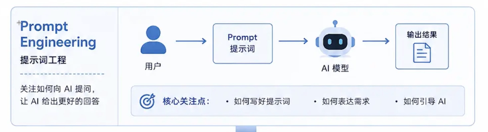
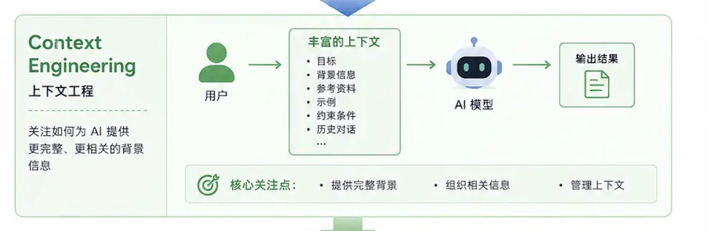
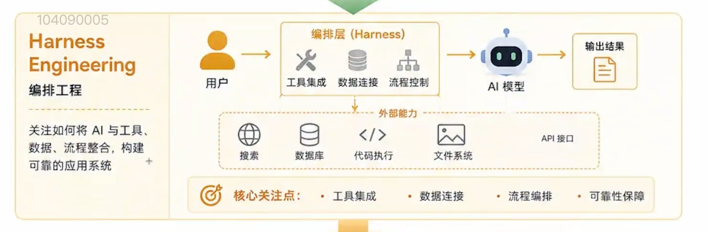
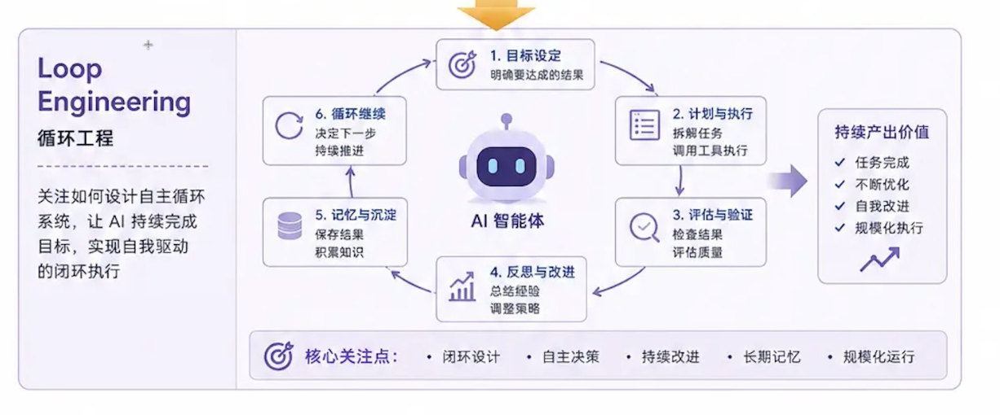
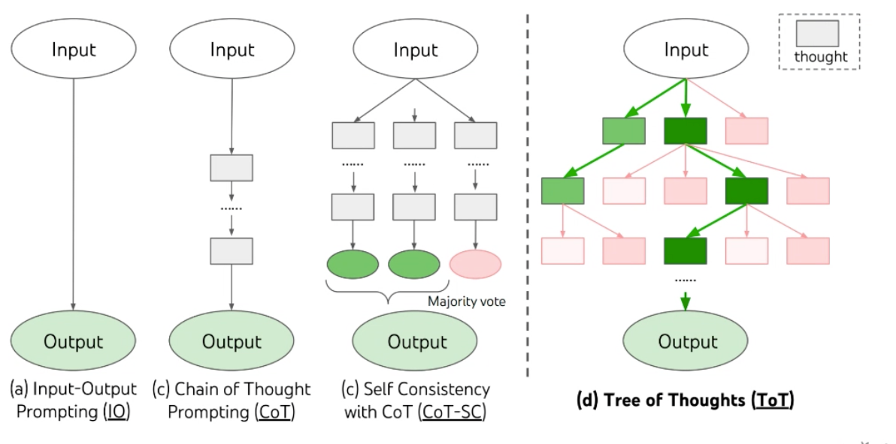

## 一、从提示词到循环系统：AI 应用的演进之路
### 1. Prompt Engineering 提示词工程：
提示词工程已经出现很久了，它的使用逻辑是用户写一段话，这段话就是提示词，发送给大模型，大模型就会给我们输出结果。
提示词工程我们一般考虑的是单轮生成，就是用户发送提示词给大模型，大模型生成结果的过程。下一次还需要再拿提示词生成结果。


### 2. Context Engineering 上下文工程
在上下文工程当中，发给大模型的就不只是这一个提示词，它还可以有解决当前这个问题相关的其他内容，这个其他内容可以包括很多内容，比如历史对话。比如问完一句还可以接着问下一句，下一句问完的时候还可以把上面问过的问题，包括大模型的回复，随着最新的问题全都一起发送给大模型。
上下文还有有目标、背景信息、参考资料、示例、约束条件、历史对话等，还可以有RAG检索知识库中文档块。
所以可以理解为上下文工程解决的是提示词工程单轮对话只能提供少量的提示词信息给大模型，导致大模型生成的结果不是很完整。这样大模型就可以根据所有内容得出更准确结果。


### 3. Harness Engineering 驾驭工程
Harness Engineering 驾驭工程在很多的一些框架里面，比如Langchain、LangGraph或者DeepSeek 也是用Agent = Harness + LLM 公式定义的。
Deepseek agent = LLM  + Harness Engineering，都是插件，一切皆插件。
我们构造一个智能体，除了大模型以外，其他的都可以认为是harness
大致可以这样理解，在编排层，我在去构造这个智能体的时候，我们里面可能会涉及到一些工具，当然这个就跟智能体有关系啊，还有可能会有一些技能，可能还会有一些知识库管理、数据库管理，可能会有一些流程控制，或者说我可能会有一些工作流的编排，那其他的还有比如说文件系统，可能还会有代码执行，我可能还有一些沙箱管理（用来做上下文隔离），可能还会有一些权限的管理，那这些其实你都可以理解成都是属于Harness需要去负责的。


### 4. Loop Engineering 循环工程
指的是我要去解决个问题，我只需要设定我的目标，然后我只需要设定我最终的评估标准，然后让他自己去执行，然后自己去按照我的评估标准去评估，如果说有问题自己去反思，然后自己去解决，然后进入下一次循环，直到达到我的评估标准为止。
那这样的话，我们就只要考虑去定任务以及去写它的评估和验证就可以了，那这个其实在实际落地的时候，这个循环工程可能还是没有那么理想。
因为第1个，你要让他自己去做，你要控制好它的边界，那会不会说他进入死循环
第2个，就是这个loop工程，它的可控性确实没有Harness这么好，我们用Harness的时候，工具、技能、数据库各方面我可以自己去把控，但是你用loop的时候，它的token消耗是非常高的，所以在企业实际落地的时候， loop工程其实相对来说少一些，那我们的智能体是不是没有循环呢？
不是，也是有的。智能体上会有一些策略，比如说像ReAct我们叫做行动观察和评估。也会去走循环，但这个循环是相对来说是比较可控的。


### 演进总结：


## 二、提示工程认知对齐
### 1. 什么是提示词
通俗讲，跟大模型说的每一句话都是提示词Prompt，专业讲，提示词是用来引导模型输出特定回答或者进行特定任务的一组词语。
提示词是我们跟大模型交互的重要途径或者是说唯一途径，就是你要去访问大模型，你就得给大模型提示词，所以可见它的重要性
### 2. 什么是提示工程
工程化的去写提示词
提示工程PromptEngineering 是一门学科，它研究如何设计和优化提示词，以最大限度地发挥LLM的能力，获得期望的、高质量的输出，采用一种工程化的思想来编写提示词。
DeepSeek 和WorkBuddy还是有一点区别的，workbody本身就是一个智能体了，所以你在这里放的提示词以外，它内部可能还会嵌套其他的提示词给你组合起来，甚至内部可能会自动去调用某些工具或技能或者专家。DeepSeek 的网页版，会把问题直接交给deepseek模型。
我们自己做智能体开发，一般是调API，它就是最原始的大模型，它里面并没有工具，你要加工具得自己手动加，然后要写提示词也得自己手动写，所以它还是会有一点点区别。

上限：
现在模型比以前模型强的原因是，参数量和训练数据上去了，现在参数量都是几万亿。
GPT4 出现的时候加入了多模态，多模态的意思在GPT4 之前它只能处理文字信息，GPT4 之后，它就可以处理图片视频这种信息了，比如说你给它一张图，它能够识别这个图是什么意思？里面有什么东西。
所以随着模型它训练的数据越多越广，那么它的能力是成一定的比例是增长的。所以这点我们要了解就是模型是有能力上限的，那我们用最强的模型，那么它的能力一般是比较强的，所以现在大家去用那种，比如说千问的max模型或者kimi K3模型，都使用最新版的最强的模型，那么它的能力其实是非常好的。

下限：
提示词的质量直接决定了我们在实际业务当中的效果或者表现的下限啊，所以它会有一个上限和下限的这么一个概念！所以我们认为呢就是他再强，你如果说不能够去激发他的潜能的话啊，我们写提示词如果不写好的话，可能你也不能够充分的去用这个模型。

### 3. 怎么写提示工程
主要根据我们的业务需求，可以大致分为这三步去不断的优化和迭代，
1.分析需求，确定目标，想好我们的思路
2.规范编写，精准描述
3.评估迭代，闭环优化，测验

怎么判断是不是一个合适的提示词，主要看是否满足你的期望和需求。如果说他生成的结果就是你需要的那他就是一个好的提示词。如果说他不满足，生成根本就不是我要的，那它就不是一个合适的。

### 4. Prompt的典型构成要素
Prompt结构模型：（不是固定的）
- 角色：角色设定（让大模型充当某个角色）、角色技能 【一般都会有】
- 背景：用户背景情况，让大模型根据当前背景更好生成内容
- 约束：显性限制/红线+偏好+风险规避/敏感项
- 流程：工作流程/步骤，引导大模型按制定步骤执行
- 示例：成功案例/失败案例/提供格式模版
- 任务：满足需求/目标的任务或任务清单

Prompt 角色定义
- 系统提示词：定义AI长期、稳定的行为边界，建议使用结构模型，这会大幅提升AI的稳定性和可控性
- 用户提示词：描述用户当前要完成的具体任务，任务是可以变化的，通常放在用户提示词中

#### 通用提示词

```markdown
# 角色：角色名称
- 角色概述和主要职责的一句话描述

## 技能：
1. 角色需要具备的技能1
2. 角色需要具备的技能2
3. 角色需要具备的技能3

# 要求：
1. 用户的具体需求1
2. 用户的具体需求2
3. 用户的具体需求3

# 任务：
- 需要让大模型执行的具体任务

# 工作流：
1. 描述角色工作流程的第一步
2. 描述角色工作流程的第二步
3. 描述角色工作流程的第三步

# 示例：
- 提供示例1:成功示例/失败范例,提供示例格式模板
- 提供示例2:成功示例/失败范例,提供示例格式模板

# 限制：
- 描述角色在互动过程中需要遵循的限制条件1
- 描述角色在互动过程中需要遵循的限制条件2
- 描述角色在互动过程中需要遵循的限制条件3
```

## 三、Prompt进阶技巧与风险控制
### 1、零样本提示（Zero-Shot）
无需向量模型提供任何示例样本，直接通过自然语言指令描述任务目标，模型即可基于自身预训练的海量知识进行理解，推理并输出答案，适用于简单通用的问答，如：翻译，简单计算

### 2、少样本提示（Few-Shot）
适用于简单通用的常识回答、跨语言互译、基础情感分类、简单数学计算等任务，尤其适合无需复杂上下文即可完成的标准化需求

### 3、思维链CoT （Chain-of-Thought 链式思考）
一种大模型提示词技术，引导模型将复杂问题拆解为多个连续的子问题，像人类一样进行逐步推理和论证，而非直接输出答案，从而显著提升复杂任务的准确性。
可与少样本结合，提供带推理步骤的示例（Few-Shot- CoT）或加上“请逐步思考”，即可开启模型的多步推理能力。

### 4、自我一致性（自洽性，Self-Consistency）
一种针对大模型推理的优化策略。通过对同一个输入Prompt进行多次独立的生成，得到多条不同的推理路径，最后通过统计投票（如多数表决）选出出现次数最多的结果作为最终答案，以此抵消单次生成的随机性误差。
商业权衡：精度与成本的取舍
1.适用于高精度，高可靠性要求任务，如：科学计算，法律判断，医疗诊断
2.响应时间增加，计算成本更高。

### 5、思维树（Tree-of-thought，ToT）
 ToT是一种扩展版CoT方法，旨在解决复杂、多路径的决策问题，尤其是那些需要探索多种可能性、权衡不同选项、需要进行全局优化的任务。适用于高度复杂的决策问题，数学证明、编程调试、多路径决策，缺点：实现复杂，计算开销极大，对模型能力要求高。

 #### 零样本/少样本 vs CoT vs 自我一致性 vs ToT
 

### 6、反思机制（Self-Reflection）
反思机制指的是在给AI的提示词中，明确要求AI在给出最终答案之后，先对自己的思考过程、推理步骤或潜在假设进行中审视和检查，模仿人类的“三思而后行”，反思机制=初步输出 + 自我审查 + 优化结果，同时会响应时间增加，计算成本更高。

### 7、风险问题
提示词注入（Prompt Injection）
攻击者通过在用户输入/间接输入中隐藏嵌入恶意指令，劫持模型的输出逻辑，使其无视原有任务目标，转而执行攻击者指定的非预期操作，是目前最常见且危害较大的Prompt攻击手段。


### 8、 Prompt安全防范措施：
1.输入内容检测
检测效果：有效识别恶意Prompt注入，直接阻断违规指令的执行流程，避免模型被滥用
2.防止身份篡改
防御成效：确保模型始终在预设框架内运行，杜绝因角色冒充导致的信息泄露或错误响应。

最小权限原则：让Agent只能访问完成任务所需的最小API集合，若需执行外部操作（如写文件、发请求）要有白名单机制，禁止直接执行Shell命令或数据库操作
内容安全检测：对输出结果进行“再审核”（Seconday LLM Filter），使用“反向Prompt”检测是否有可疑内容（如请求泄露信息，绕过安全机制），在生产环境中加一道人工或规则检查。
上下文沙箱化：将每次对话或任务上下文隔离，避免不同Session共享全局Prompt或全局记忆
日志与监控：对每一次用户输入与模型响应记录日志，若检测到恶意注入模式（如重复请求内部Prompt），自动封禁或限速，结合异常检测模型判断“非正常交互行为”。