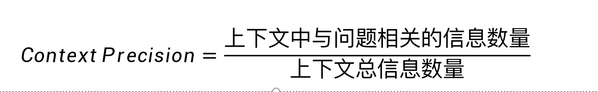
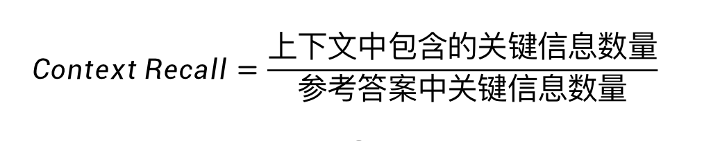
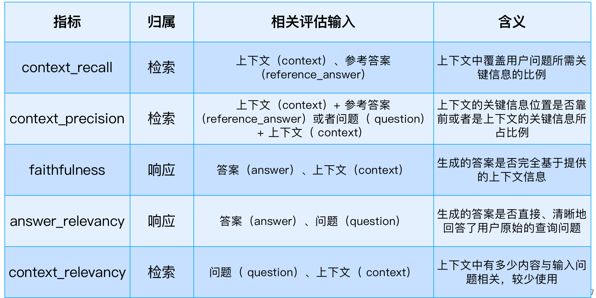

## 一、RAG评估的依据和指标
### 1、RAG应用的评估必要性
当我们准备将一个基于大模型的 RAG 应用投入生产时，有一些问题是需要提前考虑与应对的：
1. 大模型输出的不确定性会带来一定的不可预知性。一个 RAG 应用在投入生产之前需要科学的测试以衡量这种不可预知性。
2. 在大模型应用上线后的持续维护中，需要科学、快速、可复用的手段来衡量其改进效果，比如回答的置信度是上升了 10%还是下降了 5%？
3. RAG 应用的“外挂”知识库是动态的，在不断维护的过程中，可能会产生新的知识干扰。 因此， 定期检测与重新评估是确保应用质量的重要手段。
4. 由于 RAG 应用依赖基础大模型，那么如何在大量的商业与开源大模型中选择最适合企业的大模型或如何知道大模型升级一次版本对 RAG 应用产生了多大影响？
### 2、RAG应用的评估方法
1. 人工评估
人工评估是RAG评估的基础方法，通过邀请专家或人工评估员对RAG生成的结果进行质量评估。评估标准通常包括准确性、连贯性、相关性等。
尽管人工评估能够提供高质量的反馈，但这种方法耗时费力，且受限于评估员的主观性和经验差异。

2. 自动化评估
自动化评估是当前RAG评估的主流和发展方向。通过利用大型语言模型和相关算法，自动化评估工具能够实现对RAG生成文本的质量评分，从而快速评估模型性能。
这种方法不仅提高了评估效率，还降低了人力成本。

### 3、RAG应用的评估类型和输入
为了评估RAG系统，我们通常使用两种类型的评估：
- 检索评估
- 响应评估
检索评估的主要目标是评估上下文相关性，即检索到的文档与用户查询的匹配程度。
它确保提供给生成组件的上下文是相关和准确的。

响应评估适用于系统的生成组件。
这些评估衡量系统根据检索到的文档提供的上下文有效地生成响应的能力。

### 4、RAG应用的评估类型和输入
RAG 应用的评估依据，即评估模块的输入一般包括以下要素：
1. 输入问题（ question）：用户在使用 RAG 应用时的输入问题。
2. 生成的答案（ answer）：需要评估的 RAG 应用的输出，即问题的答案。
3. 上下文（ context）：用于增强 RAG 应用输出的参考上下文，通常在检索阶段生成。
4. 参考答案（ reference_answer）：输入问题的真实的正确答案，通常需要人类标注。

基于这些评估依据，对 RAG 应用进行评估时，按评估类型的常见指标如下：
- 上下文相关性（ Context Relevancy）
- 上下文精度（ Context Precision）
- 上下文召回率（ Context Recall）
- 忠实度（Faithfulness）
- 答案相关性（Answer Relevancy）

### 5、检索评估
1. 常见评估指标 - 上下文相关性（ Context Relevancy）：
检索出的上下文与输入问题之间的相关性，即上下文中有多少内容与输入问题相关。

若用户提问 “埃菲尔铁塔的建造年份？”，
检索器返回：
埃菲尔铁塔于 1887 年动工，1889 年竣工。
巴黎是法国的文化中心。
尽管第二个片段与巴黎相关，但未包含建造年份的信息。
此时context_relevancy会根据关键信息（如 “1887”“1889”）的存在与否进行评分，而非仅统计相关片段的数量，这个一般用的比较少。

2. 常见评估指标 - 上下文精度（ Context Precision）：
在具体的定义上，这个有点争议，
一种说法是：检索出的上下文（context）中与参考答案（reference_answer）相关的部分在上下文（context）中是否出现在最前面的位置，这种较为常用。
另一种说法是：检索到的上下文（context）中 相关信息的比例，可以理解为

问题：“苹果公司的总部在哪里？”
上下文：“苹果公司（Apple Inc.）成立于 1976 年，总部位于美国加利福尼亚州库比蒂诺市，CEO 是蒂姆・库克，主要产品包括 iPhone 和 Mac。”
分析：问题关注 “总部位置”，上下文中仅 “加利福尼亚州库比蒂诺市” 相关，其余（成立时间、CEO、产品）无关 → 精确率 = 1/4=25%。

3. 常见评估指标 - 上下文召回率（ Context Recall）：
衡量检索到的上下文中是否包含回答问题所需的全部关键信息，或者说检索到的上下文（context）与参考答案（ reference_answer）之间的一致程度，有时也称为命中率（ hit_rate）

问题：“《三体》的作者是谁？哪一年出版？”
参考答案：“刘慈欣，2006 年。”
上下文：“刘慈欣，中国科幻作家，2006 年开始在《科幻世界》连载《三体》。”
分析：参考答案的关键信息是 “刘慈欣” 和 “2006 年”，上下文均包含 → 召回率 = 100%。
反例：若上下文仅包含 “刘慈欣”，未提 “2006 年”，则召回率 = 50%

上下文精度：准确性
上下文召回率：命中率
### 6、响应评估
响应评估适用于系统的生成组件。这些评估衡量系统根据检索到的文档提供的上下文有效地生成响应的能力。
其中的常见评估指标：
- 忠实度（Faithfulness）
- 答案相关性（Answer Relevancy）

1. 忠实度检查生成的响应是否准确无误，即生成的答案与检索出的上下文的一致性，或者说生成的答案能否从检索出的上下文中推理出来

2. 答案相关性指生成的答案与输入问题的相关性，即生成的答案是否完整且不冗余地回答了输入问题，不考虑生成的答案的正确性。

#### （1）常见评估指标 - 忠实度（Faithfulness）：
生成的答案（ answer）是否完全基于提供的上下文（context）信息，没有捏造、幻觉或与上下文矛盾的内容。
将生成答案拆解为原子事实（如时间、地点、事件），逐一检查是否能在上下文中找到直接依据，如果存在上下文未提及的信息，即使正确，若上下文无依据也视为不忠实

问题：“爱因斯坦在哪一年获得诺贝尔奖？”
生成答案：“爱因斯坦于 1921 年因光电效应研究获得诺贝尔物理学奖。”
上下文：“1921 年诺贝尔物理学奖得主阿尔伯特・爱因斯坦，获奖理由为‘发现光电效应定律’。”
分析：答案中 “1921 年”“光电效应”“诺贝尔物理学奖” 均来自上下文，无额外信息 → 忠实度 = 100%。
反例：若答案添加 “他当时在普林斯顿大学任教”（上下文未提及），则忠实度下降。
#### （2）常见评估指标 - 答案相关性（Answer Relevancy）：
生成的答案（answer）是否直接、清晰地回答了用户原始的查询问题（question） 。即使答案忠实于上下文，但如果答非所问，那么这个答案也是无效的。

问题：“如何煮咖啡？”
生成答案：“咖啡豆需研磨至中粗度，用 90℃热水冲泡 3 分钟。”
分析：答案直接针对 “如何煮” 的步骤，包含关键动作（研磨、冲泡温度、时间）→ 相关性高。
反例：若答案为 “咖啡豆起源于埃塞俄比亚”（回答 “起源” 而非 “方法”），则相关性低。
### 7、评估指标总结

## 二、常用的RAG评估工具
### 1、Ragas
RAGAS 是一个用于评测检索增强生成（RAG）应用的评测框架，它的核心目标是提供一套综合性的评测指标和方法，以量化地评测RAG管道(RAG Pipeline)在不同组件层面上的性能。
RAGAS 特别适用于那些结合了检索（Retrieval）和生成（Generation）两个主要组件的RAG系统，支持Langchain 和 Llama-Index。

https://github.com/explodinggradients/ragas
- 评估检索质量：
context_precision   context_recall
- 评估生成质量：
faithfulness   answer_relevancy

Ragas 的 Context Precision（上下文精度）是一种衡量检索系统返回的上下文（文本块集合）中与查询相关的文本块比例的指标。
它的定义稍稍有点不同，它通过对每个相关文本块的位置k计算Precision@k值，反映关注相关文本块的排序质量（如是否排在前列），而传统 Context Precision 则反映检索结果的整体相关性密度。

### 2、Trulens
TruLens是一款旨在评估和改进 LLM 应用的软件工具，相对独立，可以集成 LangChain 或 LlamaIndex 等 LLM 开发框架。
使用反馈功能来客观地衡量 LLM 应用的质量和效果。包括分析相关性、适用性和有害性等方面。TruLens 提供程序化反馈，支持 LLM 应用的快速迭代，这比人工反馈更快速、更可扩展。