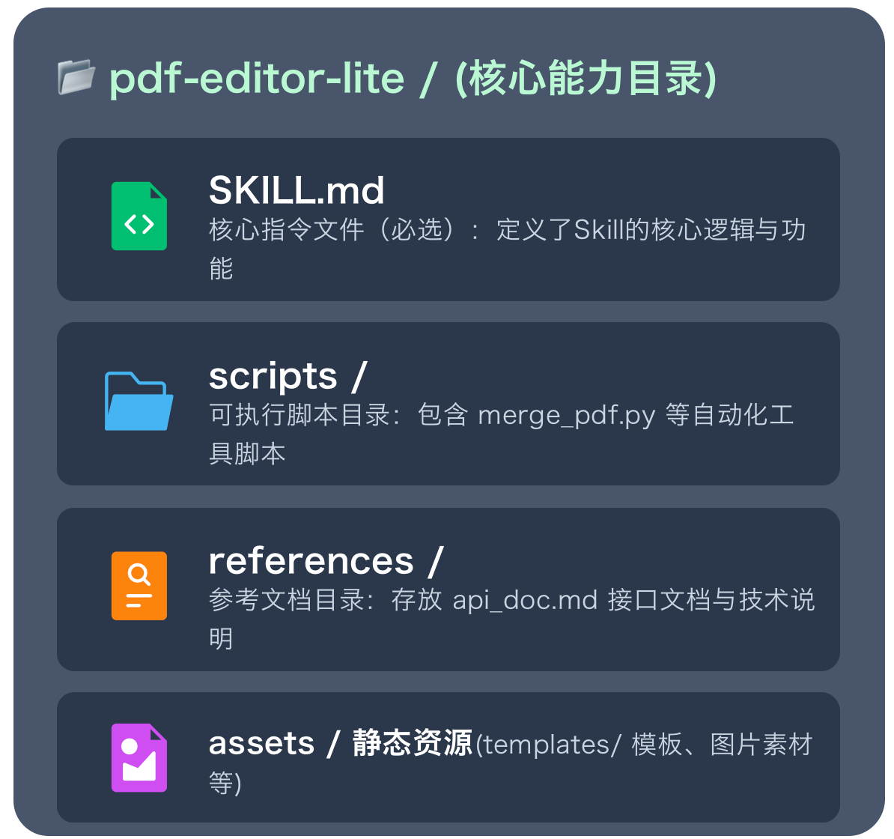

## 一、AI Agent 的“翻车”现场
1. 登录测试无限卡壳
核心问题：无法有效识别验证码，导致流程陷入死循环，在登录页面耗时二十分钟无进展。

2. 日志分析判断失误
核心问题：缺乏对业务特定日志格式的理解能力，误将标准时间戳识别为系统错误码进行分析。

3. 代码修复流程脱节
核心问题：虽能生成代码，但无法与内部工具链交互，不知道通过飞书/钉钉提交 MR 的实际流程。

核心痛点：Agent 演示像天才，干活像傻子 —— 能聊不能干。
## 二、魂拷问：模型不够强吗？
不是，模型能力已足够强大
GPT-4、Claude 4 等前沿模型在语言理解与生成任务上表现卓越，具备极高的逻辑推理与知识储备能力。

根本原因是：模型本质是“语言理解与生成”
它并非“操作系统内核”，缺乏对真实物理/数字世界的直接交互能力，无法自主处理复杂的环境异常。
这些只能交由agent主程序做。

agent工程落地，想要有很好的实践，需要满足以下要求：
1. 确定性的执行
任务必须按预设逻辑和步骤，准确、稳定地推进，拒绝随机发散。
2. 环境的感知
能主动识别验证码、网络超时、页面卡顿等运行时异常，并做出响应。
3. 工具的操控
具备调用外部API、执行自动化脚本、模拟鼠标键盘操作UI的能力。

结论：agent不好使瓶颈不在于模型本身，而在于缺乏能落地的“能力单元”

给 Agent 装上“手和脚”
人之所以能干成事，核心逻辑在于：大脑负责思考决策，手脚负责落地执行，两者缺一不可。
目前的 Agent 困境，仅有强大的“大脑”（LLM 大模型），却缺少灵活的“手脚”（自动化执行单元），无法真正落地干活。
所以使用skill 为 AI 装上手和脚的技术方案，赋予 Agent 真正的工具使用能力与任务执行力。
Skill其实是一个方案，颗粒度比MCP或Function call 大

## 三、Skill 的官方定义（Anthropic 标准）
一种开放的技术协议：
通过结构化的文件夹（包含指令逻辑、执行脚本、所需资源）来扩展 Agent 的原生能力，是连接 Agent 通用智能与特定领域专业知识的桥梁。

1. Skill优势和特点：
- 高度模块化：每个 Skill 专注解决一个独立、具体的问题，边界清晰，解耦设计。
- 代码可复用：一次编写完成，可被不同的 Agent 实例多次调用，避免重复造轮子。
- 功能可组合：支持多个原子 Skill 自由组合编排，共同协作完成复杂的业务任务。
- 动态加载：Agent 可根据当前任务需求，灵活地实时加载或卸载对应的 Skill。

2. Skill 的本质：SOP 的数字化资产化
将人类在特定领域积累的 SOP（标准操作程序）等流程性知识，通过结构化的方式进行封装，转化为 AI Agent 可以“消化”并自动执行的标准化数字资产。

## 四、Skill 目录结构
1. SKILL.md
核心指令文件（必选）：定义了Skill的核心逻辑与功能
解决方案的封装
2. scripts /
可执行脚本目录：包含 merge_pdf.py 等自动化工具脚本
3. references /
参考文档目录：存放 api_doc.md 接口文档与技术说明
4. assets / 
静态资源(templates/ 模板、图片素材等)
 

## 五、SKILL.md 解剖
一个skill通常是由YAML 元数据 和 Markdown 正文组成
1. YAML 元数据 (Metadata)：
模型的「索引卡片」：定义技能的核心身份信息，帮助模型快速判断当前对话场景是否需要激活并调用该 Skill。
---
name: pdf-processing
description: 提取 PDF 文本、合并拆分文档，用户处理 PDF 时调用。
license: MIT
---
2. Markdown 正文 (Body)
模型的「工作指南」：提供详尽的任务执行逻辑、上下文约束与操作细节，指导模型在调用后如何高质量地完成具体任务。
# 技能核心说明文档
## 适用的具体业务场景 (When to Use)
## 详细的任务执行步骤 (How to Do)
## 关键的边界注意事项 (Attention)

## 六、渐进式披露：Skill 的省 Token 秘诀
与Prompt相比
- Agent 启动时仅加载核心 name 与 `description：元数据可以减少~100 Tokens
- 任务匹配成功后才完整加载 SKILL.md 指令集：指令层可以减少5000 Tokens
- 模型推理判定需要时才读取 References 或执行脚本：资源层按需动态加载

## 七、工作流示例：Agent 如何使用 Skill
1. 用户提问：帮我把这个 PDF 转成 Word
2. 大模型检索元数据：发现 pdf-processing Skill 符合当前需求
3. 大模型读取 SKILL.md：查阅文档，明确需要调用 pdf_to_docx.py 脚本
4. Agent 执行脚本：运行命令：python scripts/pdf_to_docx.py input.pdf
5. 获取执行结果：任务完成，将转换后的文件路径返回给用户

核心洞察：Agent 并不需要自己编写复杂的转换代码，它的核心价值在于根据用户需求进行“决策”和“调度”，将任务分发给最合适的 Skill 去执行。

## 八、实操指南 — 从使用到“调教”
### 1、如何让 Agent 拥有“超能力”？
1. 寻找 Skills 核心市场
- 官方仓库：直接访问 Anthropic 官方 GitHub 技能库
- 社区生态：OpenClaw、Cursor 插件市场等活跃社区
2. 下载 Skill 一键启用
- 放置目录：将下载文件夹拖入项目的 .claude/skills/ 目录
- 自动加载：Agent 启动时会自动扫描并加载新技能

### 2、两种调用模式：显式 vs 隐式
1. 显式调用 (Explicit)
核心逻辑：用户主导，指令明确
用户通过特定的指令前缀（如 @符号）直接告诉 Agent 需要调用哪个 Skill，系统接收到明确的信号后立即执行。

典型指令示例
@pdf 帮我把这份合同文档转为高清图片格式

2. 隐式调用 (Implicit)
核心逻辑：Agent 主导，智能匹配
Agent 自动解析用户的自然语言需求，结合 Skill 的元数据描述（功能、参数等）进行意图匹配，自动激活最合适的 Skill 来解决问题。
自然语言交互示例
用户：“这份合同对方没法编辑，帮我处理一下” → 自动激活pdfSkill

### 3、从零写一个“测试报告分析”Skill
核心需求：自动化测试报告分析
每日自动解析 JUnit XML 报告，自动计算并输出通过率、失败用例详情及 Top3 崩溃堆栈信息。
1. Step 01 · 创建项目目录
初始化项目根目录：test-report-analyzer/，作为所有代码和配置的容器。
2. Step 02 · 定义技能规范 (SKILL.md)
明确输入源（XML路径）、输出数据结构（JSON）及边界错误处理逻辑。
3. Step 03 · 编写解析脚本
开发scripts/parse_junit.py，实现XML解析、通过率计算与堆栈提取。
4. Step 04 · 技能集成测试
将 Skill 完整目录交付 Agent，使用真实的历史测试报告进行调用验证。

### 4、编写高质量 SKILL.md 的三条铁律
1. 触发条件要精准：
写清楚“当用户提到 JUnit XML 且需要计算通过率时调用”，明确模型的触发时机。
2. 边界要写死：
明确网络超时重试3次、文件不存在报错、SQL只允许SELECT语句等规则，规避异常风险。
3. 输出要结构化
要求返回固定的 JSON Schema，规范数据格式，方便 Agent 进行下一步的自动化处理。

### 5、避坑指南：Skill 开发常见误区
1. 代码组织混乱
典型错误：直接在 SKILL.md 中塞入数千行代码，导致文档臃肿、维护困难。
推荐做法：核心逻辑迁移至 scripts/ 目录；MD 文件仅保留功能说明与调用指令。
2. 描述信息模糊
典型错误：description 字段仅写“处理文件”等模糊词汇，缺乏关键词，无法被索引。
推荐做法：包含具体业务关键词（如“提取 PDF 元数据”），精准描述功能，提升匹配度。
3. 依赖环境缺失
典型错误：依赖库需用户手动安装，操作门槛高，且容易因环境差异导致运行失败。
推荐做法：脚本内置依赖自动检测与安装逻辑；或使用 Docker 沙箱封装完整运行环境。

## 九、工程化落地 — 从玩具到生产
### 1、企业落地三件事（测试团队视角）
1. 盘点手工作业
打开终端历史记录，筛选做过5次以上的高频操作，将其统一封装成可复用的 Skill。
2. 规范设计
定义清晰的输入输出参数，完善异常错误处理逻辑，形成团队统一的开发与交付标准。
3. 单元测试
Skill本质是代码，代码必须具备可测试性。这也是Skill相比传统Prompt工程的核心优势之一。

### 2、Skill 的版本管理策略
1. 遵循 Git 语义化版本
严格遵循语义化版本规范命名，例如：v1.0.0, v1.1.0, v2.0.0，让版本变动逻辑清晰、状态可追溯。
2. 重大变更升级 Major 版
当进行不兼容的核心功能迭代时，必须及时升级主版本号（Major），最大程度避免影响现有依赖旧版本的 Agent 稳定运行。
3. 搭建内部 Skill Registry
建议企业搭建私有 Skill 仓库（类似 npm），实现 Skill 资产的统一版本管理、安全高效分发与精细化的权限控制。

### 3、安全与沙箱：不让 Skill 变成“特洛伊木马”
核心风险隐患
Skill 脚本可能被植入恶意指令（如 rm -rf /）或非法窃取环境变量，若缺乏管控，AI 助手极易沦为攻击系统的“特洛伊木马”。

1. 人工代码审计 重点
强制要求所有 Skill 脚本代码可审计，由安全团队进行人工 Review，从源头拦截恶意逻辑与漏洞。
2. 容器沙箱隔离
基于 Docker 容器构建独立的隔离环境（如 MS-Agent 的 ms-enclave 方案），将脚本执行限制在受控空间内。
3. 权限最小化
遵循最小权限原则，仅授予 Skill 访问指定工作目录的权限，严禁跨目录读写或调用系统敏感接口。

### 4、性能优化：Skill 太多会不会影响模型反应速度？
1. 核心疑问
100 个 Skill 的元数据占据约 10k tokens，是否会导致模型推理速度显著下降？
2. 完全不会
采用渐进式披露机制，仅注入 Skill 核心元数据（单 Skill 仅几十字），整体 Token 开销极低，对响应速度影响微乎其微。
3. 进阶优化
针对超大型项目，建议引入 RAG 动态检索机制，根据用户提问实时召回相关 Skill，替代全量注入，大幅提升系统运行效率。

## 十、Prompt和Skill的区别
Prompt 和 Skill 是两个不同层级的概念。Prompt 是“这一次怎么做”的临时指令，而 Skill 是“以后这类任务都按什么方法做”的可复用操作手册
核心区别一览
| 对比维度       | **Prompt (提示词)**    | **Skill (技能)**                         |
| :------------- | :--------------------- | :--------------------------------------- |
| **本质**       | 对话中的自然语言指令   | 包含指令、脚本和资源的文件夹             |
| **持久性**     | 临时，不跨对话保留     | 永久，一次创建，跨对话复用               |
| **加载方式**   | 每次全量输入           | **渐进式加载**，按需触发                 |
| **内容范围**   | 单次任务的上下文和方向 | 标准化流程、领域知识、脚本工具           |
| **Token 消耗** | 每次对话都消耗         | 未触发时仅消耗约 100 tokens 的元数据     |
| **复用性**     | 低，每次需重新描述     | 高，一次定义，全局可用                   |
| **触发方式**   | 用户手动输入           | Claude 自动判断或用户 `/skill-name` 调用 |

